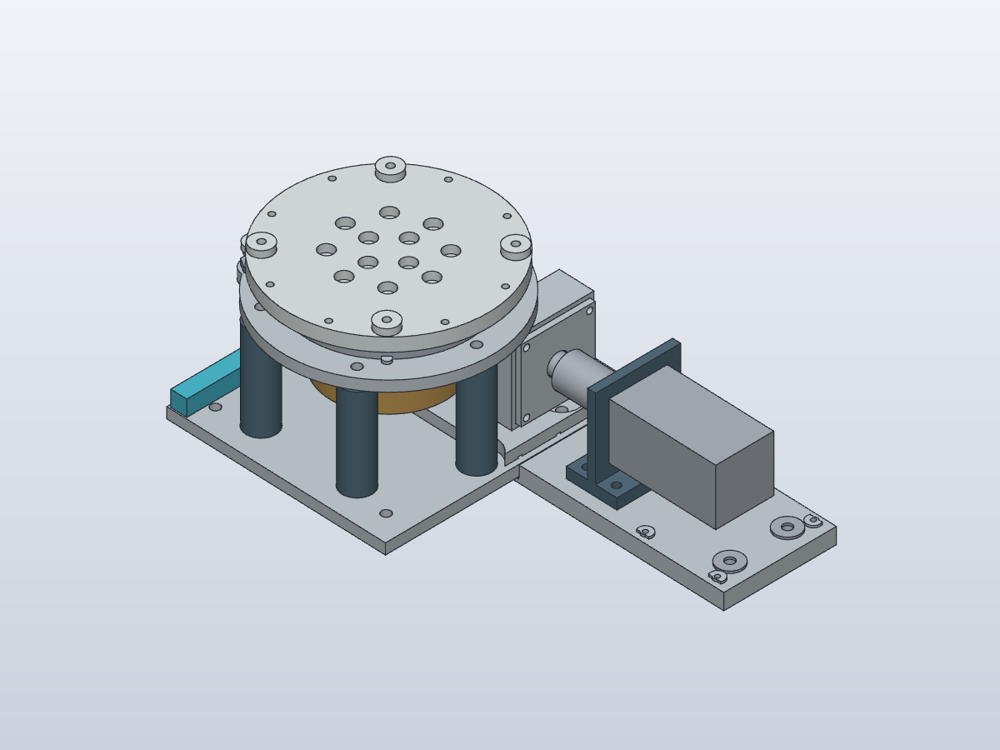
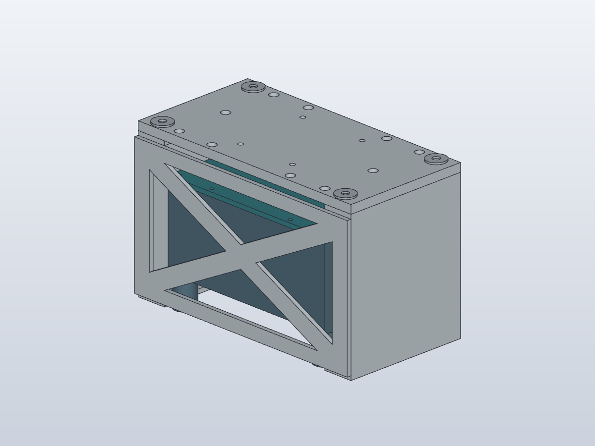

# Michelaingelo

A robot-carving project starting with foam. RT-01 is a **single-axis rotary worktable**: the workpiece turns on a 320 mm platter about vertical Z, while the SO100 sits on a fixed steel stand above the controller box. The stand and rotary core bolt to the same rigid workbench. The printed box carries no arm load.

## Current design — revision 5

The [18 November audit and response](docs/rotary-table-design-audit-2026-11-18.md) records the latest service, fastener and sealing corrections and what still requires physical measurement. The [17 November response](docs/rotary-table-audit-response-2026-11-17.md) records the earlier precision-core changes.

The precision core now uses a **machined metal hub, one-piece worm-bearing carrier, metal retainer caps and integral motor foundation**. Purchased crossed-roller and angular-contact bearings support a 40:1 KHK duplex worm drive. Metal pilots, a carrier guide and a drive pin replace the former printed alignment/clamp interfaces. This adds machining beyond the original two-plate concept.

The assembly has **25 A1 Mini printed pieces plus a fit coupon** in yellow PETG. Grey CAD parts are made to order and black parts are bought off the shelf. Four top-down fasteners engage M50 with recessed tips, clearing the driver for rearward removal. The prototype accessories include four [arm seats](docs/rotary-table-printing.md#prototype-arm-seats) made from the imported foot geometry and a [first foam fixture](docs/rotary-table-printing.md#prototype-foam-fixture). Check the arm screw lengths after fitting the seats.

This is **prototype geometry for review, not a fabrication release or tested precision/load/waterproof rating**. The 5 kg payload, 4/8 N·m drive torque and 0.10° reversal error are acceptance targets. Actual bearings, shaft retention/preload, motor/coupling, electronics/cables, fixtures, bench thickness and stand fabrication still need the decisions/tests listed in the specification. Homing does not measure output-angle error. Bracing does not smooth the purchased arm's commands or remove internal backlash.

## Review and build files

- [michelaingelo.sc](michelaingelo.sc) — native SolidCraft assembly; named views **RT01 and arm reference**, **RT01 assembly**, **RT01 top**.
- [Audit response](docs/rotary-table-design-audit-2026-11-18.md#revision-5-response-for-review) — decisions and evidence for R4-01–R4-14.
- [Mechanical specification](docs/specs/rotary-table.md) — geometry, machining fits, load targets, sensor, sealing and acceptance requirements.
- [Validation report](docs/rotary-table-validation.md) — current checked results and explicit limits.
- [Fastener register](docs/rotary-table-fasteners.md) and [CSV](cad/fastener-shopping-list.csv) — 23 active groups with 119 screws and bolts, including four measured-fit arm screws and 18 bench anchors whose lengths depend on the bench.
- [Bill of materials](docs/rotary-table-bom.md) — printed parts, fabricated parts, bought hardware and pending selections.
- [Printing/assembly guide](docs/rotary-table-printing.md) — coupon map, first articles, print orientation and assembly/service sequence.
- [Print package](exports/rotary-table/rt01-print-package.zip) — 25 oriented assembly STLs, fit coupon, removable drain catch, manifests, guides and metal references.
- [Assembly STEP](exports/rotary-table/rt01-assembly.step), [metal parts](exports/rotary-table/metal/), [seal profiles](exports/rotary-table/seal-profiles.step) — bought devices are labelled simplified envelopes; STEP files are not tolerance drawings.
- [Arm source](references/so-arm100/README.md), [mount coordinates](cad/arm-mount-reference.json), [historical designs](docs/archive/) — preserved reference/context.

## Working on the model

Units are millimetres. Use the SolidCraft MCP/CLI to preserve named features/components. Update the governing specification, register, checks and exports together. `scripts/rebuild_assembly.py` generates a separate candidate around the existing arm; `cad/rotary-table-build.json` builds the table alone. Regeneration commands are in the printing guide. Do not replace the main assembly with a standalone build or save temporary probe hardware into it.

The dust/splash design uses an overlapping skirt, fixed upstand/gutter, sealed static seams and gasketed electronics box. It needs physical ingress/temperature testing. Scaling requires new loads, fits, drive/bearing sizes and structural calculations; uniform scaling of this model is not supported.

