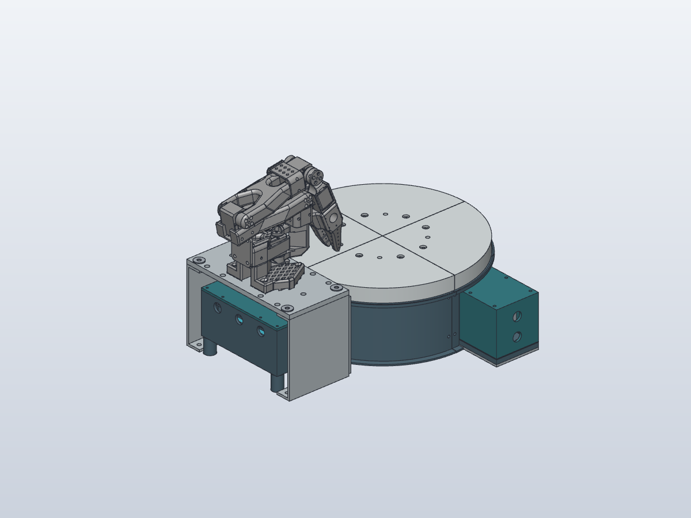
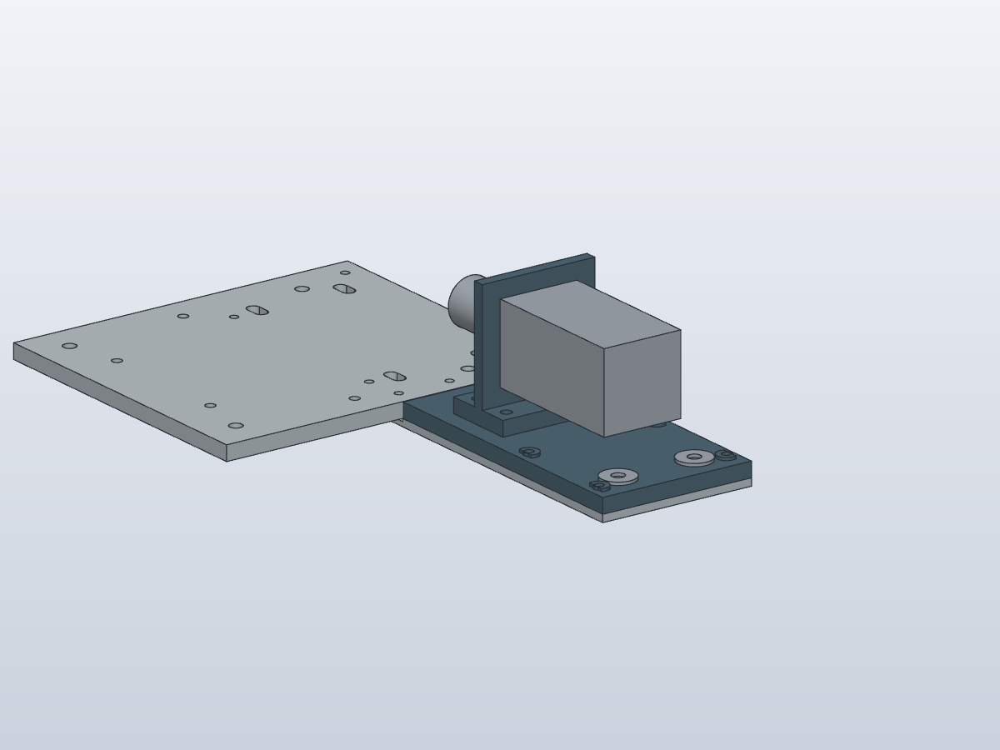

# Michelaingelo

A robot-carving project, starting with foam and progressing toward larger stone work. The current mechanical task is a **single-axis rotary worktable**: the workpiece turns on a horizontal platter around vertical Z, while the SO100 sits on a fixed metal bridge above the controller box.

## Current direction

The old stationary base and orbital-arm concept are superseded. The SO100 follower is mounted above the controller box, facing the platter. Its aluminium mounting plate is carried by two welded steel side channels and a front X brace, through-bolted to a rigid workbench with steel backing strips. The printed box and lid carry no arm load. The same workbench anchors the rotary core.

The RT-01 baseline uses a **320 mm segmented platter, a purchased crossed-roller bearing, an adjustable duplex worm drive, a closed-loop NEMA17 motor provision, and a separate gasketed electronics box**. The user approved printed parts with a metal core: two aluminium datum plates support the bearing through metal compression tubes. Covers, platter sections, mounts, hub and service-box parts are designed around the Bambu Lab A1 Mini's 180 mm build volume.

Read the [rotary-table specification](docs/specs/rotary-table.md) before modifying geometry or ordering hardware. It was written before this CAD rebuild and defines loads, layout, tolerances, printing, seals, motor/controller envelopes and validation gates.

## Design status

The specification defines prototype revision 3: braced arm support and a detailed assembly fastener register. The old base is removed. All 19 imported arm bodies retain their geometry and relative joint pose, with a new rigid placement and mount above the controller box. The table has a working vertical revolute joint and a one-revolution motion study.

The revision 3 validation report records model health, table rotation with fastener envelopes, arm mounting, lid access, source consistency and print-mesh checks. See the [validation report](docs/rotary-table-validation.md) for the current evidence and limitations. The design still has **33 printed assembly pieces plus a fit coupon**; the steel stand is fabricated separately.

This is **prototype geometry, not a fabrication release or a tested load/precision/waterproof rating**.

- 5 kg workpiece/fixture target, initially foam; structural and drive tests remain necessary.
- Four platter sections and modular covers fit the A1 Mini; print tolerances must be calibrated with the supplied coupon.
- Metal bearings, gears, shafts and coupling are purchased parts. Reference envelopes do not manufacture or fully define them.
- Dust and splash protection uses an overlapping rotating skirt, a fixed upstand/gutter, sealed static seams and a gasketed electronics enclosure. No certified IP rating is claimed.
- Driver and control-board spaces are reserved; final electronics, wiring, thermal performance and robot motion control are separate integration work.
- Scaling keeps the bearing/drive/load-path arrangement. It requires new load calculations and component sizing, not uniform CAD scaling.

The motor platform now rests on a continuous aluminium sole plate with recessed core fasteners and two bench anchors through metal sleeves. The arm adapter has ten lid-tool access holes and leaves 28 mm over the controller lid, which lifts and slides rearward for servicing. Its mounting pattern follows the four existing SO100 base passages.

The arm has not been tested on this stand. Bracing addresses anticipated reaction loads; it does not smooth the purchased arm’s control or remove its internal backlash. A loose wood block is not the mounting basis. Bench anchor lengths remain formulas until the top thickness is measured.

The final bearing variant, motor/driver/coupling and sensor drawings still need selection. The worm shaft's key/shoulder/preload stack and wheel attachment need machining drawings. Complete those interfaces, print-fit calibration, and loaded accuracy/temperature/ingress tests before treating the assembly as a carving machine.

## Project files

- [michelaingelo.sc](michelaingelo.sc) — SolidCraft assembly with the mounted SO100 reference; open **RT01 and arm reference**, **RT01 assembly**, or **RT01 top** under Named Views.
- [docs/specs/rotary-table.md](docs/specs/rotary-table.md) — governing mechanical and fabrication specification.
- [Assembly fastener register](docs/rotary-table-fasteners.md) — 24 joint records, 106 fixed-length screws, 18 thickness-dependent bench bolts, mating hardware and unfinished interfaces. [Purchasing CSV](cad/fastener-shopping-list.csv).
- [Parts and purchasing notes](docs/rotary-table-bom.md) — printed pieces, metal parts, reference hardware and fastening provisions.
- [Printing and assembly guide](docs/rotary-table-printing.md) — coupon identification, orientations, supports, assembly and regeneration commands.
- `cad/` — reproducible CAD build commands and part manifest.
- [Print package](exports/rotary-table/rt01-print-package.zip) — 33 oriented STLs, coupon, manifest, current hardware register, guides and custom-metal STEP files.
- [Assembly STEP](exports/rotary-table/rt01-assembly.step), [metal parts](exports/rotary-table/metal/) and [gasket profiles](exports/rotary-table/seal-profiles.step) — neutral CAD; bought parts are labelled reference envelopes.
- [Validation report](docs/rotary-table-validation.md) — geometric checks, limitations and remaining release checks.
- [docs/archive/base-and-arm-README-2026-11-17.md](docs/archive/base-and-arm-README-2026-11-17.md) — superseded design notes, preserved for context.
- [references/so-arm100/README.md](references/so-arm100/README.md) — pinned arm reference and original import limitations.

## Working on the model

Open `michelaingelo.sc` in SolidCraft. Model units are millimetres. Use the SolidCraft MCP/CLI to preserve its parametric features, named bodies and assembly structure. Keep the specification, README and validation report consistent with geometry, and distinguish selected hardware from packaging envelopes.

The native assembly includes the mounted arm; `cad/rotary-table-build.json` generates the table and support bridge without importing the arm. `cad/mount-so100.json` records its mounting transform and rigid joint. Use a separate output file when replaying it. The pre-mount version is archived as [rt01-before-support-and-arm-mount.sc](docs/archive/rt01-before-support-and-arm-mount.sc). The original open model is preserved as [docs/archive/pre-rotary-table.sc](docs/archive/pre-rotary-table.sc).

