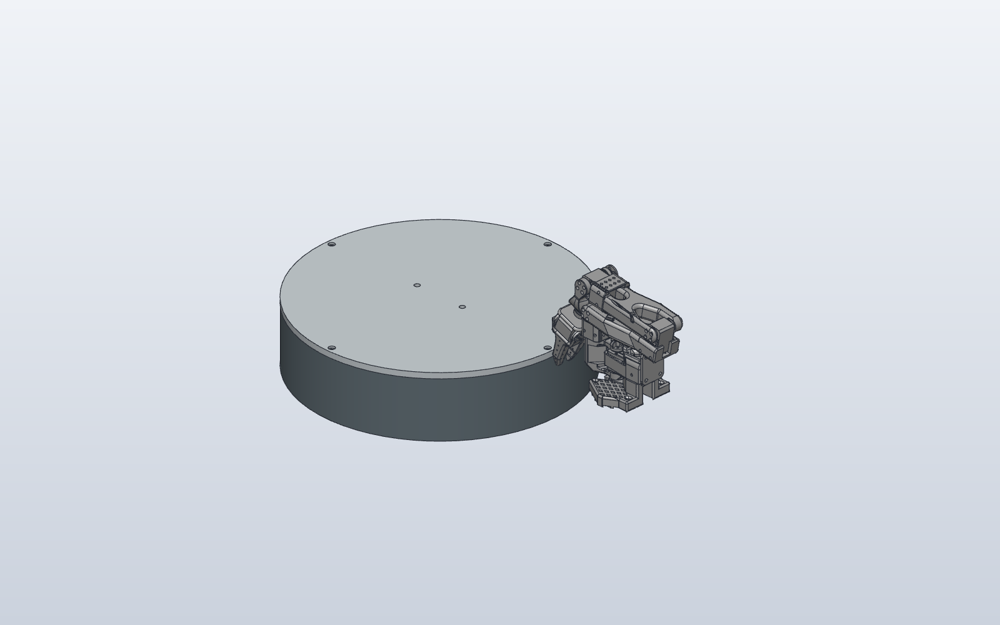
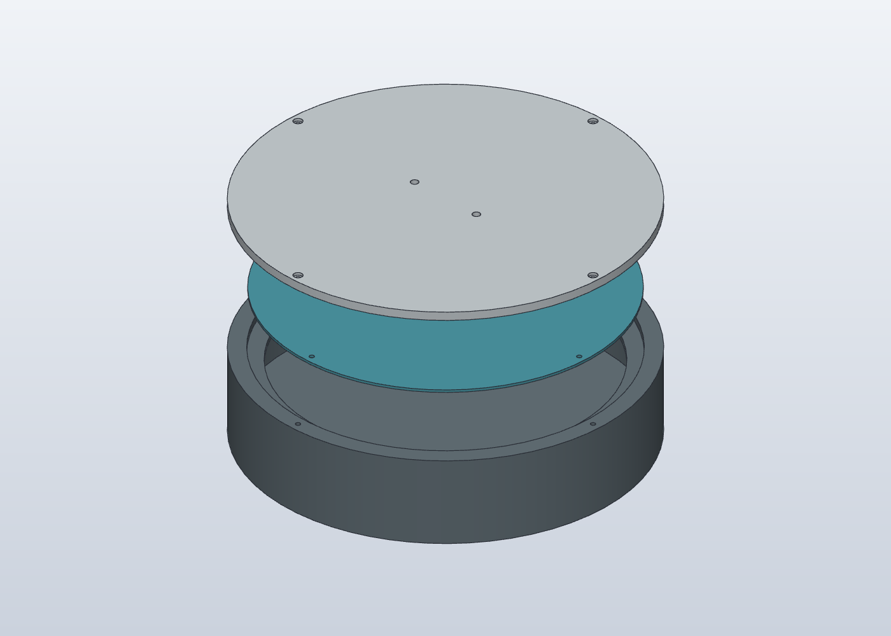
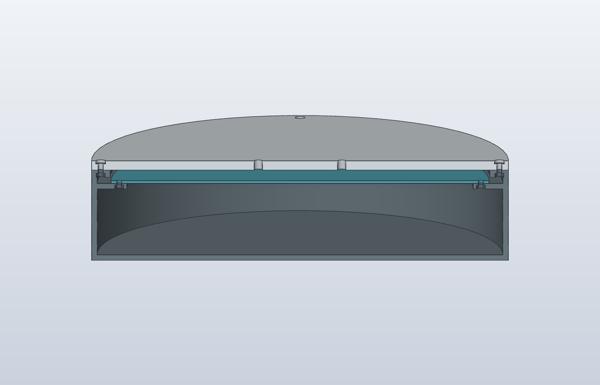
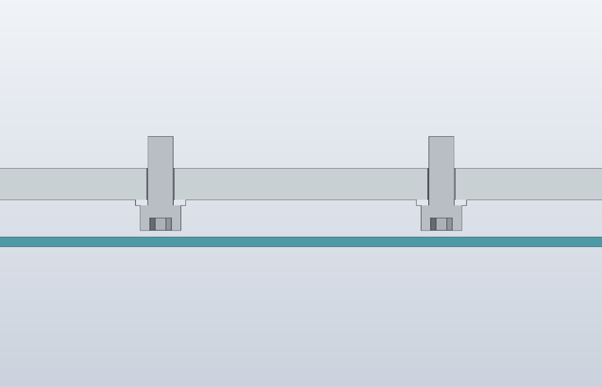
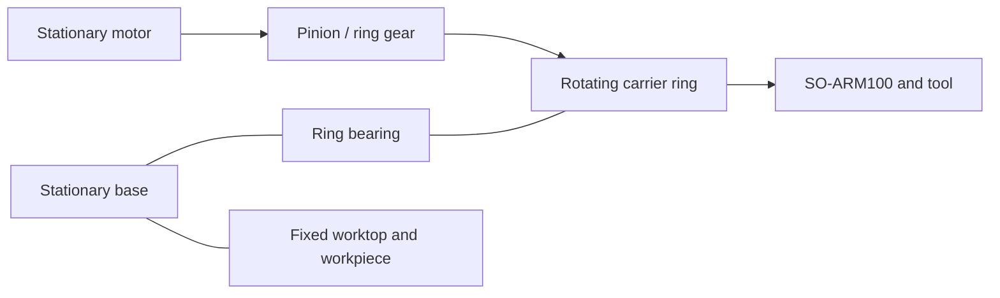

# Michelaingelo

A 3D stone carving machine for shaping stone, marble, and other suitable carving materials. The first milestone is a functional prototype that can be built and used, initially carving polystyrene foam with a machine made mostly from 3D printed parts.

The goal is to combine scanning and carving around a central circular platform. The motion concept is similar to a 360° spin camera booth: an actuator beneath the platform moves a robotic arm around the material being worked on.

## Machine concept

- **Central platform:** the user places the stone on a circular base in the middle of the machine. The stone stays in place while the arm travels around it.
- **Orbital drive:** an actuator beneath the base drives the mechanism that carries the arm around the platform. The orbital motion should reverse direction; continuous rotation is not required.
- **Robotic arm:** reuse and modify the user's existing LeRobot SO-ARM100 to position the scanning equipment and carving head relative to the material. Designing a new robotic arm from scratch is outside the current scope.
- **Cameras and sensors:** mounted on the arm to scan the stone and capture its shape.
- **Modular carving head:** mounted at the tip of the arm. The user changes individual cutting bits manually, choosing finer or thicker tools to produce different details and finishes. Interchangeable complete tool heads are a possible later extension.

The intended workflow is to place and secure the material, scan its geometry, plan the carving, and remove material with the selected tool. Tool changes allow different stages of shaping and detail work.

## Agreed development direction

| Topic | Requirement or direction |
| --- | --- |
| First milestone | Build and use a functional carving prototype |
| Initial workpiece material | Polystyrene foam; softer and cheaper materials can precede stone |
| Initial machine construction | Mostly 3D printed parts, using a Bambu Lab A1 Mini; selected larger parts may be ordered from an external printing service |
| Robotic arm | Existing LeRobot SO-ARM100, with modifications for integration; no new arm design from scratch |
| Sculpture goal | Freestanding sculptures, starting with simpler test shapes if needed |
| Tool access | Reach the workpiece from all angles except underneath; the mechanism and reachable geometry still need to be worked out |
| Initial platform size | Approximately 450 mm diameter, an MVP estimate that can change |
| Initial workpiece load target | Up to 5 kg; a design target requiring validation, not a tested load rating |
| Workpiece height | Derive from the existing arm's usable reach, its mounting position, and the fitted tool |
| Orbital travel | Reversible motion around the stationary workpiece |
| Tool changes | Manual changes of individual cutting bits |
| Input | A user-supplied 3D sculpture model; file format to be defined later |
| Software | Project-specific machine software is planned; software design and implementation are outside the current scope |
| Budget and footprint | No fixed limits specified; determine them from the design requirements |

The longer-term goal is a much larger machine that carves rock and produces fully finished sculptures. A fully finished surface is not an early prototype requirement; numerical accuracy and surface finish targets remain open. Dimensions, construction, and load capacity for the larger stone-carving version have not yet been defined.

## Existing hardware and fabrication

- **Arm:** the user owns a LeRobot SO-ARM100. Confirm the exact hardware revision and whether the available hardware is a follower arm or a leader/follower pair before dimensioning its mounting interfaces. The [original SO-ARM100 documentation](https://github.com/TheRobotStudio/SO-ARM100/blob/main/SO100.md) is the reference for this arm; SO-ARM101 parts and specifications must be checked for compatibility before use.
- **Printer:** Bambu Lab A1 Mini. Its [official build volume](https://bambulab.com/en/a1-mini/tech-specs) is 180 × 180 × 180 mm. Check custom parts in their intended print orientation against this envelope. Larger parts may be outsourced; the user has accepted that option.
- **Cutting tool:** no rotary tool or spindle is currently owned or selected. Tool dimensions, mass, cutting bits, and mounting interface remain open.

The current mechanical scope covers the central platform, the mechanism that moves the existing arm around it, the arm mounting and required modifications, the carving-tool adapter, and mounting provisions for cameras and sensors.

Use the original [SO100 STEP files](https://github.com/TheRobotStudio/SO-ARM100/tree/main/STEP/SO100) and [SO100 URDF](https://github.com/TheRobotStudio/SO-ARM100/blob/main/Simulation/SO100/so100.urdf) as reference geometry, checking them against the owned hardware. The URDF defines five arm-motion joints and a separate gripper joint.

A [local SO100 reference set](../../references/so-arm100/README.md) includes the base, base attachment, first-motor holder, servo geometry, full follower assembly and individual base print meshes. Its README records the pinned source revision, measured CAD dimensions and SolidCraft import limitations.

Determine the usable carving envelope from the actual arm geometry, joint limits, mounting position, tool offset, and clearances. No fixed workpiece height, tool-weight limit, or cutting-load capacity has been established yet.

## Current CAD model

The SolidCraft model contains a first base layout with three main assembly components. The default loading view shows a clear worktop with two fixing holes; the separate M8 bolt and washer reference models are hidden. Dimensions are parameterized; the model is still a layout for review, rather than a fabrication release.

The same file now includes the full SO100 follower assembly beside the base, under **SO100 follower arm - unmounted reference → Base_08q** in the Browser. The arm stands upright with its mounting base horizontal at Z = 0 and its gripper facing inward toward the platform (−X). Its original joint bends remain folded, and its scale is unchanged. Its X offset is `so100_reference_x = base_d / 2 + 175 mm` (currently 400 mm), solely to keep the reference separate for review; the arm carrier and mounting position remain to be designed. Saved Named Views **Base and SO100 reference** and **SO100 reference close-up** provide overview and detail views. The [reference notes](../../references/so-arm100/README.md) record the orientation and source import warnings.

| Part or space | Current model |
| --- | --- |
| Worktop lid | 450 mm diameter × 10 mm thick, flat and removable |
| Workpiece fixing positions | Two 9 mm through holes, 90 mm apart, for the selected M8 bolts |
| Worktop retention | Four recessed M5 button-head screw positions on a 430 mm bolt circle |
| Empty fixing-access gap | 12 mm between the worktop underside and electronics-cover top |
| Electronics cover | 408 mm diameter × 3 mm thick, retained separately by four M5 screw positions on a 390 mm bolt circle |
| Cover removal opening | 410 mm diameter, giving the cover 1 mm radial clearance when lifted out |
| Housing | 450 mm outside diameter × 100 mm high; nominal 6 mm walls and floor |
| Worktop support | A 20 mm wide annular rim, 8 mm thick |
| Cover support | A separate internal annular shelf below the access gap |
| Electronics space | Approximately 79 mm central clear height above the floor, below the cover |
| Assembled height | 110 mm, including the worktop |
| Position | Worktop at Z = 0–10 mm; housing below it at Z = −100–0 mm |

The worktop and housing carry the workpiece load through the outer support rim. The thin electronics cover is a separate divider below the worktop. Hexagonal nut pockets are included beneath both screw patterns; nut retention and fit must be finalized for the selected hardware and fabrication process.

### Base screw and nut specification

The base uses **two screw types, ten screws in total**: eight identical M5 screws for the lids and two M8 screws for the workpiece. Four screws per lid are the prototype design choice, subject to physical validation.

Both lids use **M5 × 20 mm fully threaded socket button-head screws, ISO 7380-1, A2 stainless steel, 0.8 mm thread pitch**, with a **3 mm Allen key**. Length is measured from beneath the head to the tip.

| Location | Required screws | Required nuts |
| --- | --- | --- |
| Worktop lid → housing rim | 4 × M5 × 20 mm ISO 7380-1 socket button-head screws | 4 × M5 DIN 934 hex nuts |
| Electronics cover → internal shelf | 4 × the same screw | 4 × the same nut |
| **Total for both lids** | **8 identical M5 × 20 mm screws** | **8 identical M5 hex nuts** |

Use **M5 × 0.8 DIN 934 A2 stainless hex nuts, 8 mm across flats and 4 mm thick**. The modeled nut pockets are 8.3 mm across flats × 4.3 mm deep. The screw and nut dimensional references are [Accu SSB-M5-20-A2](https://www.accu.co.uk/socket-button-screws/8152-SSB-M5-20-A2) and [Accu HPN-M5-A2](https://www.accu.co.uk/hexagon-nuts/7891-HPN-M5-A2).

The model accommodates this common hardware as follows:

- All lid and mating housing through holes are 5.5 mm diameter.
- The four worktop holes have 10.5 mm diameter × 3.25 mm deep flat-bottom counterbores. These receive the 9.5 mm diameter × 2.75 mm high screw heads, leaving them nominally 0.5 mm below the work surface.
- The inner-cover screw heads sit on its top surface, within the 12 mm fixing-access gap. Their nominal clearance to the worktop underside is 9.25 mm.
- The worktop screw tips clear the inner support shelf by 1.75 mm. The inner-cover screw tips extend about 11 mm beneath that shelf; reserve at least 12 mm below it at those four locations when placing electronics.
- Nut engagement, retention, and tightening torque need physical validation with the chosen fabrication process.

### Workpiece fixing interface

The base interface uses **two M8 × 22 mm fully threaded socket cap-head screws, DIN 912 / ISO 4762, A4 stainless steel, 1.25 mm thread pitch**, fitted upward through the lid into threaded receivers in the workpiece fixture. They use a **6 mm Allen key**. The pair is spaced 90 mm apart to resist workpiece rotation. The unused centre hole has been suppressed in the model.

| Part | Quantity | Selected specification / reference |
| --- | --- | --- |
| Rock bolt | 2 | M8 × 22 mm fully threaded socket cap-head, A4; [Accu SSCF-M8-22-A4](https://www.accu.co.uk/metric-cap-head-screws/4038-SSCF-M8-22-A4) |
| Washer between each bolt head and lid | 2 | M8 DIN 125 A4, 8.4 mm bore × 16 mm outside diameter × 1.8 mm maximum thickness; [Accu HPW-M8-A4](https://www.accu.co.uk/metric-flat-washers/72523-HPW-M8-A4) |

The selected washer is 1.4–1.8 mm thick within its stated tolerance. **When fitted**, the bolt threads project **10.2–10.6 mm above the plate into the workpiece fixture**: `22 − 10 − washer thickness`. Remove these bolts while positioning the workpiece, then insert them from underneath. The bolt's maximum 13 mm diameter × 8 mm high head, plus the washer, occupies 9.8 mm of the 12 mm access gap, leaving **2.2 mm minimum clearance** above the electronics cover. The 9 mm plate holes give 0.5 mm radial clearance around the M8 shanks.

The workpiece fixture must provide two **M8 × 1.25 threaded receivers, 90 mm apart**, and accommodate the full projecting bolt length without bottoming out. How that fixture grips or attaches to the carving material is a separate design task: the foam prototype needs a suitable carrier or clamp, and a later stone fixture must suit the actual stone. The fixing strength and resistance to carving forces require validation before use.

Both bolts and washers are separate removable hardware, hidden by default under **Worktop lid → Removable M8 bolts and washers**. Turn on that component's eye icon to inspect the fitted hardware. They are simplified fit references; helical threads are not modeled. The worktop itself has two clearance holes and no permanent locating posts. The workpiece and its receiving fixture are outside the current base model.

### Workpiece fixing and access

1. Remove the worktop from the housing and set the two M8 bolts and washers aside. Position the workpiece and its suitable carrier/fixture on the clear plate, aligning the fixture's threaded receivers with the two fixing holes.
2. Keep the lid's underside accessible and insert the M8 × 22 bolts and washers from underneath, then tighten them with a 6 mm Allen key. Do this before mounting the lid on the housing; the 12 mm gap is for fitted-hardware clearance, rather than hand/tool access. Validate the fixture's grip on the material and the complete connection before carving.
3. Lower the secured worktop/workpiece assembly onto the housing rim and fasten its four M5 retaining screws. The electronics cover remains in place underneath, separating the shallow fixing gap from the component compartment.
4. For electronics access, remove the worktop, undo the four M5 cover screws, and lift the inner cover through the 410 mm opening.

The 5 kg workpiece target has not been load-tested or structurally validated. Plate material, printed-part construction, nut retention and the foam carrier fixture remain open. The housing also needs segmentation and joining details for A1 Mini fabrication; the two larger lids can be considered for outsourced manufacture. PCB mounts, motor mounts, wiring exits, and actuator clearances will follow the selected hardware.

Base geometry checks completed: seven closed solids (three visible base parts and four hidden M8 bolt/washer references), no assembled base-solid overlaps, and all three sketches fully constrained. A trial change to a 470 mm base diameter, 120 mm housing height, 14 mm fixing gap and 100 mm workpiece-fixing spacing rebuilt without errors before restoring the current dimensions. These checks establish geometric fit; they do not validate fastening strength or cutting loads. The saved exploded view is named **Base service access**.

The imported arm adds 19 placed bodies: 18 closed solids and one open surface. The combined project therefore contains 26 placed bodies, 25 closed. The arm import has the documented upstream tolerance/seam warnings; there are no failed timeline features, and the base geometry is unchanged by the addition.

## Proposed arm rotation

Keep the worktop, workpiece, housing, and electronics stationary. Carry the SO-ARM100 on a separate ring around the outside of the base. One bearing ring attaches to the stationary structure; the other supports the rotating arm carrier. A stationary motor drives that carrier through a pinion and toothed ring, with reversible travel.

This is the proposed motion arrangement, not a modeled drive assembly. [Igus documents a fixed inner ring and driven outer ring](https://www.igus.com/product/iglidur_PRT_04_TO), along with [belt and gear drive options](https://www.igus.eu/slewing-ring/faq). These are references for the mechanism, not selected components. Bearing size, arm mounting distance, gearing, motor size, housing openings, and cable travel remain to be worked out together.

## Open mechanical and hardware questions

- Exact SO-ARM100 revision, available arm configuration, and mounting geometry.
- Usable workpiece height and width from the existing arm's reach and tool orientations, and how the foam is secured.
- Filament choice and construction of custom parts within the A1 Mini print envelope, including which larger parts to outsource.
- Initial test sculpture and the tool positions and orientations needed to carve it.
- Bearing arrangement, actuator, and transmission for the orbital motion beneath the base.
- Worktop material and stiffness, a workpiece fixture suited to foam first and stone later, housing segmentation and joints, and validation of the 5 kg workpiece target.
- Arm mounting position, clearances, required modifications, and stiffness during carving.
- Tool drive, head dimensions and mass, mounting interface, and supported cutting bits.
- Camera and sensor selection, placement, and provision for calibration.
- Positioning accuracy, repeatability, and acceptable surface finish for the foam prototype.

Scan processing, carving plans, toolpaths, and machine-control software will be addressed separately. Mechanical provisions for the scanning equipment remain part of the machine concept.

## Project files

- `michelaingelo.sc` — native SolidCraft base model with the unmounted SO100 follower reference assembly.
- `README.md` — project concept, current geometry, and open design questions.
- `docs/base-exploded.png`, `docs/base-section.png` and `docs/base-fixing-section.png` — SolidCraft renders of the current base and M8 workpiece-fixing interface.
- `references/so-arm100/` — official SO100 STEP/STL reference files, upstream license, source hashes, previews and import checks for future arm-mounting work.
- `.gitignore` — excludes local system files, SolidCraft locks, and backup files.
- `.gitattributes` — treats SolidCraft containers as binary files in Git.

## Working on the project

Open `michelaingelo.sc` in SolidCraft. Use SolidCraft's MCP for CAD changes, and save the native model back into this directory. Model dimensions are in millimetres.

Keep this README aligned with the model as the machine develops, distinguishing the planned machine from components already modeled.
