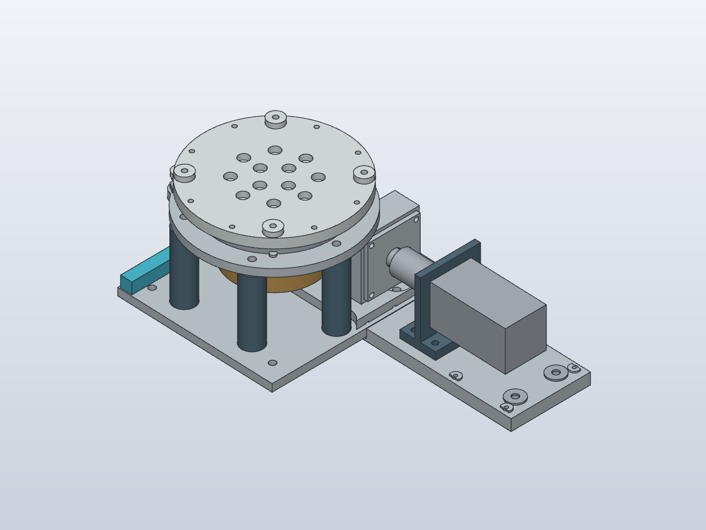

# RT-01 revision 4 — audit response and implementation review

2026-11-17. **The twelve findings are materially valid for revision 3.** The collision and documentation findings are reproducible; the audit's estimates of slip, eccentricity and resulting performance are conditional, not measurements of a built machine. Revision 4 addresses each finding below in the model, source, hardware register and exports. Physical qualification and the previously unfinished purchased-component interfaces remain open.

This document began as a decision/verification plan before CAD edits. The following is the completed implementation record. The [original audit](rotary-table-design-audit-2026-11-17.md) and its baseline evidence remain preserved. Current results and hashes are in [revision 4 evidence](audit-evidence/2026-11-17-rt01/revision4/summary.json) and the [validation report](rotary-table-validation.md).

## Review scope and tradeoff

The printed hub, separate printed worm supports/sled/caps, printed motor foundation and horizontal sensor bracket are retired. Their critical locating/clamping functions move into metal. That removes eight prints: **25 assembly prints plus a new coupon**, with **17 metal fabrication bodies**. This costs more machining than the former two-plate concept, but avoids asking calibrated PETG clearances and compression sleeves to establish the precision drivetrain.

The 320 mm platter, purchased 40:1 duplex worm pair, vertical C axis and independent braced arm support remain. All 19 arm bodies retain their shape and relative pose; the whole reference is raised 8 mm with the stand. No arm internals were edited. The delivered hardware schedule contains 23 active groups, 101 fixed-length screws and 18 bench bolts. F08/F12 are retired; F25 is added. Do not reuse the old print package or bolt list.

## A01 — Retainer screws crossing block bolts

**Verdict:** confirmed assembly blocker. Eight horizontal M4 shanks intersected vertical M5 block bolts; assembly order could not fix it.

**Applied:** M60 is a single machined carrier with integral bearing supports. F08 and its holes no longer exist. M61 metal caps use eight F09 M4×12 screws into metal: 7.15 mm nominal engagement, at least 9 mm full thread and 10 mm drill depth. This also supports A06's common bearing datum.

**Verified:** every F09 head/washer/shank is in the complete hardware population; no unexpected intersections at assembly, all rotation poses or ±3 mm carrier travel. F07 heads remain outside the integral blocks. Fit shaft/bearings after using the covered core-anchor access holes. Use side-entry hex access to the front carrier screws with the upper plate installed; full wrench-handle ergonomics are not certified by the solid check.

**Review gate:** confirm cap/outer-ring contact against the actual bearing drawing and finish the shaft retention/preload drawing. These are independent of the removed bolt crossing.

## A02 — Housing anchor washers entering the wall

**Verdict:** confirmed blocker for the specified OD15 washers at (105, 105).

**Applied:** move anchors to (88, 108), rotated by quadrant. This location clears both the wall and the motor-foundation floor opening; simply moving along the old diagonal would not establish the latter.

**Verified:** all four complete F16 head/washer envelopes pass. Washer-to-wall clearance is 150 − hypot(88, 108) − 7.5 = **3.19 mm**. Closest washer edge is **3.0 mm** from the motor opening, so the floor supports its footprint. Floor thickness stays 2.5 mm; anchor length formulas are unchanged.

**Review gate:** printed floor clamp force and sealed penetrations must pass first-article/ingress checks. The result applies to the 320 mm baseline; reducing the radius requires rechecking these fixed anchor coordinates.

## A03 — No concentric bearing/hub register

**Verdict:** true. Screw clearances allowed translation. The audit's resulting mesh variation was a conditional example, not measured eccentricity.

**Applied:** replace P30 with M20 metal hub: Ø54.98 bearing pilot, Ø14.98 wheel pilot, shoulder reliefs and machined face datums. M02 gains an interrupted outer-bearing register. Matched steel columns locate M01/M02 with one round recess and one slot; M01's guide locates the worm carrier. Screws clamp these interfaces instead of locating them through clearance holes.

**Verified:** closed geometry, intended ring/face contacts, 1.0 mm hub-flange clearance above the stationary bearing, source/STEP agreement and full rotation. The [machining table](specs/rotary-table.md#3-metal-location-machining-and-inspection) specifies measured mating fits, ≤0.01 pilot concentricity, wheel radial TIR and assembled axis inspection.

**Review gate:** the model proves the features exist; only machining and measurement prove concentricity. Confirm the purchased ring chamfers/seals and rework any assembled datum stack outside the stated limits before adjusting mesh.

## A04 — Uncontrolled sleeve clamp and wheel torque path

**Verdict:** true design omission. Equal 36/36 and 8/8 nominal stacks did not guarantee clamping. The 1.146° example was the geometric sleeve-contact case after loss of face friction, not measured operating backlash.

**Applied:** remove the hub sleeves and use a solid metal hub-to-wheel clamp stack. Add M21 ground Ø4×12 steel pin at R15 and a matched radial wheel slot. The pilot locates radially; the slot controls tangential play without a second competing radial locator. M40 combines sole/riser in metal, eliminating P23 and its equal-length anchor sleeves. F14 now clamps metal directly. F10/F17 thread into M40; F06 changes to M5×16 into M20.

**Verified:** pin/slot side gap is approximately 0.005 mm per side in CAD, bottom clearance 0.7, hub engagement 6.5 and wheel engagement 5.5. Maximum specified slot contribution is **0.0382°**. The specification records the 533 N peak pin force, shear/bearing/bending demands and required certified pin strength; it does not treat nominal pin diameter as a torque rating. Full hardware and rotation checks pass.

**Review gate:** approve pin fatigue/contact strength, wheel threads, bolt preload and anti-loosening with the fabricator; measure loaded reversal and cycling. The printed platter/motor bracket still need creep/clamp testing. This change removes the identified sleeve mechanism, not every source of drivetrain compliance.

## A05 — Home-sensor retention under the platter

**Verdict:** the representative AF13 nut really collided. This did not establish that every M8 sensor was impossible; the unfinished layout needed an actual sensor/retention package.

**Applied:** select SICK IME08-02BPSZT0S as the mechanical reference and mount it axially through a supported pad on M02 at R73/210°. Model its 50 mm body, both AF13 nuts at conservative 4 mm thickness and an initial connector/cable reservation. A mild-steel Ø12×3 target is screwed to a hub boss with F25 M3×8; there is no glued flag or unsupported printed bracket.

**Verified:** measured target gap **1.2 mm**, sensing-face edge to bearing **9.0 mm**, upper nut to hub **8.7 mm**. Ordinary hub background is 7.5 mm above the face. Conservative edge-based clearance exceeds the manufacturer's 8 mm lateral / 6 mm overhead installation dimensions. All retained parts rotate without collision, including targeted column crossings. F12 and P25 are removed.

**Review gate:** confirm supplied nut thickness ≤4, select the matching cordset/input interface, and demonstrate one home event per revolution with a 0.9–1.5 mm working gap. Supplier safe range is 1.62 for the standard target; real target/countersink/background and temperature need a signal test. Sensor IP67 is not a machine rating. [SICK drawing](https://www.sick.com/media/pdf/6/86/386/dataSheet_IME08-02BPSZT0S_1040870_en.pdf).

## A06 — Worm-bearing location and retention

**Verdict:** true. A Ø35.30 printed seat did not establish a stable Ø35 outer-ring axis; axial backlash adjustment did not correct Y/Z location.

**Applied:** machine both Ø35.01 seats and shoulders in one M60 setup; retain outer rings with metal M61 caps and selected M62 shims. Add M01's 60×6 guide tongue and the carrier's 68×6.02 groove. The complete bearing/pilot/column/guide chain now has machining and assembled inspection requirements.

**Verified:** ±3 mm travel passes with all eight F09 stacks, bearings, shaft and worm moving together. Nominal guide end margin is 1 mm at either limit. Cap retention uses **D − W + t − h**, nominal 11.05 − 11 + 0.05 − 0.10 = 0; measured shims must give 0–0.005 mm outer-ring axial clearance. Assembled centre distance target is 55.500±0.030, with explicit bore coaxiality/axis-squareness checks.

**Review gate:** approve these fits for the actual bearing/load/temperature, inspect the real cap annulus against its outer ring, and finish inner-ring preload/shaft retention separately. Metal nominal geometry is not a measured axis-alignment result. The torque-through-360° test remains mandatory.

## A07 — Curved seam washer seats

**Verdict:** confirmed nominal seating conflict. Moving washers outward alone would reduce thread projection and still leave a curved seat.

**Applied:** cut Ø10 flat washer pockets at the documented local Y153/X153 planes. Preserve the 16 mm grip and F15 M4×25 stack, two 0.8 washers, 5 mm nyloc and 2.4 mm projection. The local remaining wall under the washer footprint is at least approximately 3 mm.

**Verified:** all 16 full seam hardware envelopes pass the complete checks. The pockets do not break into the cavity; the actual fastener passage remains the intended sealed penetration. All four strips now print flat (A11).

**Review gate:** validate low clamp force, washer seating, PETG creep and seam sealing on real prints.

## A08 — Driver removal with the arm installed

**Verdict:** true for the documented straight-lift route and full 35 mm reservation. The audit did not prove every tilted removal path impossible.

**Applied:** raise the braced stand/arm plate 8 mm. M50 underside is Z144, leaving 40 above the open box rim. Keep the rear open. Extend the steel channel webs/front brace; the box and lid remain unloaded by the arm.

**Verified:** 13 ordered service checks cover ten tool shafts, lid/gasket lift 8 and rearward withdrawal, tray/controller lift 27 and withdrawal, and the full driver lift 70 and withdrawal. Driver at Z106–141 has **2 mm rim clearance and 3 mm plate clearance**. All poses pass with no unchecked pairs. All 19 arm bodies match the baseline after the single +8 mm Z translation.

**Review gate:** actual connectors, service loops, driver attachment and thermal-pad release need a demonstrated procedure. The taller stand needs the same real load/weld/bench qualification as before; the CAD change is not a measured stiffness improvement or a cure for abrupt arm commands.

## A09 — Rotating fixture screw tails

**Verdict:** the example long screws really hit fixed hardware; severity depended on actual fixture stack and angle.

**Applied:** replace open captive-nut holes with blind M6 metal threads in raised M20 bosses. Require 8–9 mm engagement. The length rule is **bolt length − fixture/washer stack above Z128 = 15–16 mm**. At the deepest permitted tip Z112, no shank projects into the stationary core. Blind drill tip ends Z108.5, leaving 2.5 mm metal above the underside.

**Verified:** four maximum-depth M6 tips are included at all sampled/targeted angles. No intersection. The target's lowest face is Z99.7 versus column-head top 97.6, a separate 2.1 mm nominal all-angle bound.

**Review gate:** design/check the actual clamps and their upper sweep. Blind holes do not make an overlong bolt safe to tighten; never bottom it out. The documented M6×20 with 4–5 mm upper stack is an engagement example, not a complete workholding assembly.

## A10 — Coupon/parameter coverage

**Verdict:** true; several production fits had no representative trial or working parameter correction, including the literal M4 pocket expression.

**Applied:** remove the retired printed bearing/pilot/nut/sleeve interfaces instead of retaining irrelevant trials. The new 150×100×24 coupon covers separate horizontal/vertical screw holes, 7 mm deep insert pilots, column bores and 5.2 mm deep fixture-boss pockets. Add dedicated hole-orientation, column, motor-pilot and fixture-boss parameters. Require full P11/P24, one platter quadrant and actual enclosure/lid first articles for long bores, mounting/clamping and seals. The printing guide states which depth/land changes require source edits.

**Verified:** eleven fit parameters enlarged together in a disposable native model: **214 features rebuilt, zero failed features**, and the expected printed bodies changed. Coupon and all production meshes pass topology/envelope checks. Metal fits have a separate inspection table; the old `rt_fit`/captive-nut workflow is retired.

**Review gate:** slice, print, measure and calibrate. This was one parameter-sensitivity trial, not a proof that arbitrary fit/radius settings are safe. No physical coupon or pull-out test was run.

## A11 — Two strips exported on edge

**Verdict:** confirmed exporter/orientation mismatch; closed meshes alone did not detect it.

**Applied:** cancel each strip's assembly quadrant rotation before laying it flat for export. Add an exporter gate for strip bounds and bottom contact area.

**Verified:** **all four** STLs are 24×84×8, with **1952.4855 mm²** bed contact each and vertical printed screw holes. Old edge-down files are replaced in the manifest/package. The corrected rotation is a proper rotation, not a reflection.

**Review gate:** normal slicer/adhesion and printed-hole inspection remains.

## A12 — Incomplete hardware and angular checks

**Verdict:** true assurance gap. The old zero-overlap result applied to the selected hardware population and did not disprove collisions in omitted groups.

**Applied:** reconcile probe counts against every active register row: **119 screws in 23 groups**, including all formerly omitted groups/head/washer/nut envelopes and the four arm-base bolts. Include permanent sensor nuts, cap shims, drive pin and four maximum fixture tips. Use **17 unique uniform angles**, targeted narrow crossings and 360° closure: **26 rotation calls**, plus both carrier limits. Add a quick assembly gate and retain separate service checks.

**Verified:** **28 hardware/movement calls: zero unexpected intersections, zero unchecked pairs, no budget truncation**. Thirteen service calls also pass. [Coverage/exclusions](../cad/hardware-check-coverage.json) names every intentional thread/press-fit pair and the unchanged imported arm self-pairs. Thread lengths/head positions are separately recorded in the register. Analytical sweep gaps supplement sampling; sampling is not continuous collision proof for an arbitrary new fixture.

**Review gate:** coverage is the current registered screw population, not all future machine hardware. Heat-set insert retention is a first-article interface; below-bench hardware depends on T; shaft/coupling/board/gland/fixture hardware remains unselected. Re-run after those choices. No probe hardware is saved into the delivered design.

## Evidence and independent re-review

- [Native file](../michelaingelo.sc), [specification](specs/rotary-table.md), [fasteners](rotary-table-fasteners.md), [BOM](rotary-table-bom.md), [printing guide](rotary-table-printing.md).
- [Validation report](rotary-table-validation.md), [machine-readable results/hashes](../cad/validation-results.json), [raw revision 4 evidence](audit-evidence/2026-11-17-rt01/revision4/).
- [Complete hardware probe](../cad/fastener-clearance-checks.json), [quick assembly probe](../cad/hardware-assembly-check.json), [ordered service probe](../cad/support-access-checks.json).
- Original failing probes remain in the parent evidence folder and target revision 3 names. Replay them against commit `a403195`, not the revised assembly. Instructions are in the original audit.

Reviewer priorities: challenge the measured-fit/tolerance chain and actual bearing corner/outer-race contact requirements; approve drive-pin/wheel/preload sizing; inspect blind fixture engagement; confirm the sensor's real signal/cable package; review the enlarged stand's fabrication and bench load path. These are explicit release gates, not hidden claims that CAD proved physical performance.

