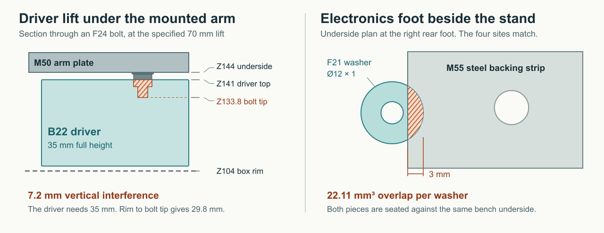

# Michelaingelo RT-01 engineering audit

18 November 2026 · SolidCraft 0.44.1 · revisions 4 and 5 · dimensions in mm unless stated otherwise

**Independent decision on the original revision 5 submission.** The driver clears the installed arm screws and all four electronics-anchor washers clear the stand backing strips. The recheck classified four original findings as closed for CAD or documentation, three as partly resolved and seven as open. Fabrication of the affected interfaces and stone-cutting release still depend on the inputs and acceptance evidence below. [Independent disposition of all 14 findings](#disposition-of-all-14-findings) · [Designer’s response](#revision-5-response-for-review)

## Outstanding work for the fixer

**Prototype stand.** Keep the 8 mm M50 plate. Measure the owned foot to finish the four seats and record the fitted stand before the stop trial. The mounting and motion profile for the reported shake are undocumented. R4-14 stays open until the tool’s movement relative to the fixture is measured during a stop. [Arm-stop test and plate decision](#arm-stop-test-and-plate-decision)

### CAD and package follow-up

**Independent review of the four fixes submitted in `14c768e`.** The remaining service defect is the loose washer at each F19 tray screw. The drain cups work at their nominal positions and need a small correction to their capacity record.

- [ ] **Tray and arm screw access (R4-01, R4-02, F19 and F24) · Partly fixed.** The F19 tray driver clears by **1.00 mm** through its turn. The F24 arm driver completes two tightening strokes at all four provisional seats under the folded arm, with **4.18 mm** minimum sampled clearance. The F19 production check joins the plain washer to the screw and raises both 7 mm. A washer can stay on the horizontal tray as the screw backs out. With the parts modeled separately at each of the four sites, the washer rests at Z82–82.50, clears the screw shank by 0.10 mm and sits **6.25 mm below the pickup**. The documented pickup cannot reach it there. **Specify a positively retained washer and matching screw, or a tool that can collect and replace the loose washer at tray height.** Model the selected retention or pickup, recheck removal and refitting at all four sites, then demonstrate both with the fitted arm and leads. [Loose-washer replay on michelaingelo.sc](audit-evidence/2026-11-18-rt01/independent-service-follow-up/f19-loose-washer.probe.json) · [Service procedure](rotary-table-printing.md#service-with-the-arm-installed)
- [x] **Worm-adjustment key (R4-04, F07) · Pass in CAD.** The 12 mm AF4 key envelope completes rear entry, two clockwise 60° strokes on each front screw, a 5 mm lift for each reset, and withdrawal. At carrier X = −3, 0 and +3, a conservative envelope enclosing every intervening angle clears the nearest column sleeve by **at least 0.475 mm**. The sampled minimum is 0.50 mm. Confirm the actual key bend and delivered clamp torque on the assembly. [Tool procedure](rotary-table-printing.md#worm-adjustment-tool) · [Carrier-limit checks](audit-evidence/2026-11-18-rt01/service-follow-up/f07-carrier-limits.results.json)
- [x] **Four drain catches (R4-10) · Collection and removal paths pass in CAD.** All 52 vertical rays at the nominal outlet positions reach a sloped cup floor. All four cups can slide 20 mm outward and lift 30 mm with the registered hardware fitted, with **1.45 mm** minimum clearance to the housing. Placement matters. Shifting a cup 1 mm outward puts three of its 13 rays on the inlet rim. Use the first-article tracer to confirm the positions and mark them for replacement. **Correct the capacity calculation to exclude the inlet sidewalls.** The modeled liquid overlaps those walls by 26.05 mm³ at the fill mark and 44.05 mm³ at the pour notch. Subtracting that plastic gives **19.87 mL at the mark and 26.30 mL at the notch**, also confirmed from the shipped STL. The nominal 20 mL label is appropriate. Actual collection, splash and clean-out still need the printed cups. [Capacity replay on the P54 native](audit-evidence/2026-11-18-rt01/independent-service-follow-up/p54-capacity-overlap.probe.json) · [Catch positioning and print file](rotary-table-printing.md#drain-catches)
- [x] **Packaged arm reference (R4-13 follow-up) · Pass.** The links in the extracted README, audit and package opening note reach the intended SO100 reference on GitHub. It opened without signing in, and the online file matched the repository copy byte for byte. [Arm reference](https://github.com/carlosgj94/michelaingelo/blob/main/references/so-arm100/README.md)

The independent replay passed all 478 production service clearances, eight seat-footprint checks, 26 platter poses and both carrier limits on the saved revision 5 assembly. The loose-washer check above exercises a state the production replay omits. [Independent tool sweeps and cup measurements](audit-evidence/2026-11-18-rt01/independent-service-follow-up/sweeps-and-placement.results.json) · [Production service results](audit-evidence/2026-11-18-rt01/service-follow-up/service.results.json) · [Current validation](rotary-table-validation.md)

### Inputs the fixer needs to finish the design

| Interface | Who supplies what | Deliverable |
| --- | --- | --- |
| **Arm foot and bench (R4-02, R4-03, R4-14)** | The builder measures the depth, slope and available bearing surface at each of the four foot recesses, plus bench thickness and underside access. The fabricator supplies the channel weld and mounting details. | Draw a supported seat for each F24 location. Measure fitted grip at each site and record screw length, 6.5–7.0 mm penetration, at least 6.0 mm full thread and tip at or above Z145. Size the bench anchors from the actual stack. |
| **Worm shaft and drive (R4-08)** | The supplier provides the bearing and coupling drawings, allowed preload, and approval for the finished worm bore and key. | Release a dimensioned B03 shaft and mating stack with shoulders, torque transfer, inner-ring retention, coupling insertion and adjustment travel. Verify the fits against the selected parts. |
| **Fixture, spindle and workspace (R4-07, R4-09)** | The operator defines the workpiece, cutting load, tool mass and reach, plus the allowable tool-to-fixture error and settling time for the cut. The integrator supplies the spindle mount, arm limits and cable or hose routing. | Draw a fixture that carries clamp load into the metal bosses with 8–9 mm blind M6 engagement. Sweep the articulated arm, tool, fixture, workpiece and services through cutting, homing and retract poses across the required table angles. |
| **Dust protection and seals (R4-10, R4-11)** | The operator specifies the rock process and cleaning method. The supplier provides the seal compound data, cable diameters and glands or plugs for three box holes and two hood holes. | Specify capture at the tool, arm and drive protection, compatible seam seal, and how to empty and clean the catch. Detail the F21 floor seal against the coupon result and check the B24 lid seal at material and dimensional tolerances. |
| **Electronics and cooling (R4-01, R4-12)** | The electrical integrator supplies device and connector drawings, operating limits and the stop/isolation scheme. | Detail board mounts, the driver-side thermal interface across the 0.25 mm gap, positive heat-sink retention, cable restraints and access to disconnect the devices. |

### Evidence the builder must return

- [ ] **Arm and stand during a stop (R4-02, R4-03, R4-14).** Return the fitted-joint record, the paired normal-stop traces and the peak tool error, settling time and residual shift for each pose. Identify where the motion occurs and whether the current plate meets the agreed limits. [Test sequence and decision table](#arm-stop-test-and-plate-decision)
- [ ] **Loaded table and fixture (R4-06, R4-07, R4-08).** Include the +Y eccentric load, measure M02 relative to M01, check for joint slip and mark the carrier before reversals. Record loaded reversal (≤0.10°), axial runout at R140 (≤0.20 mm) and tangential deflection at R140 under 10 N in each direction (≤0.20 mm). Record rim and seam height change, clamp creep and sleeve movement. [Load cases and acceptance targets](specs/rotary-table.md)
- [ ] **Printed seals, drains and hood (R4-05, R4-10, R4-11).** Trial the actual F21 seal, washer and nut in the coupon at the proposed 0.75 mm installed seal thickness. Record squeeze, imprint, extrusion, leakage and retained clamp after dwell. On the first articles, inspect the lid imprint and gutter lip, service and reseal the hood, then run an unpowered tracer through repeated rotation and cleaning. Record where it drains and inspect inside the drive and dry box. Recheck the home signal. [Coupon and assembly instructions](rotary-table-printing.md)
- [ ] **Installed tools, service, heat and stopping (R4-01, R4-02, R4-04, R4-09, R4-12).** Demonstrate the actual F07 tool can apply the required clamp torque for two successive strokes at each front screw. Check F24 engagement, access and clamp load with the fitted seats. Remove and refit all four F19 screws and washers, the tray and the driver with the arm installed, selected connectors and real thermal interface. Verify board, sink and cable retention. Log closed-lid temperatures at intended duty and verify stop, isolation and restart behavior for the arm, table and spindle. [Tool and service procedures](rotary-table-printing.md#service-with-the-arm-installed)

For each completed item, add the candidate revision, changed drawing or procedure, and a link to the measured result in this audit. After a CAD or hardware change, update the affected probes, rerun the rotation and installed-service checks, and record the worst clearance for the parts and tools selected. For an open item, name the missing dimension, supplier drawing or physical test. Keep the arm-vibration and stone-use decisions open until their machine measurements are available. [Production validation](rotary-table-validation.md) · [Independent replay](audit-evidence/2026-11-18-rt01/independent-revision5/recheck.py)

## Revision 4 findings

**Two documented operations fail with the specified hardware installed.** The driver hits four arm-mount bolts during removal. Under the bench, four electronics-foot washers occupy the same space as the stand backing strips. A third finding affects the arm’s primary load path. None of its four upper washers seats on the imported foot at the height assumed by the fastener register. Resolve these three together before drilling the bench or releasing the mounting drawings.

**Two features deserve early testing for rock work.** A ray through the platter seam reaches the worm carrier, and the printed rim extends 85 mm past the metal hub. A spindle mount, stone fixture and dust capture still need to be designed. The current performance targets are for an initial foam prototype. Actual chatter, tool-tip error and dust exposure require measurements on the equipped machine. [Governing specification](specs/rotary-table.md) · [BOM](rotary-table-bom.md)

**The arm’s abrupt stops need a separate acceptance test.** The present stand calculation attributes most of the metal flex to the mounting plate. A 20 N fore/aft load gives 0.013 mm of movement over the platter centre and 0.046 mm with the arm surrogate raised and extended. The fastener seats and the actual bench still govern whether this assembly can hold a cut. [Arm stand under abrupt stops](#arm-stand-under-abrupt-stops)



## What was checked

| Check | Result on the audited geometry |
| --- | --- |
| Native file | SHA-256 `ec2f769737bc460da0205142b2fdd3fcab7844b11034e9225c389dcfc5e7f18b`. A sourcing-group update arrived during the audit. All 100 world-space body bounds and volumes match the first snapshot exactly. The principal checks below were rerun on the updated file. |
| Model health | 705 timeline entries, zero failed features, seven solved sketches with zero DOF. All 81 table/support bodies are closed. The 19 imported arm bodies include one open surface, `SO_ARM100_08k_Mirror`, and the import feature carries warnings. |
| Constraint and contact coverage | 17 rigid joints and one revolute C axis. The solver reports zero floating groups. An independent nearest-neighbour check covered all 100 placed bodies. The only bodies with positive distance to every neighbour were B07 (optional encoder space, 2.00), B22 (driver space, 0.25) and the imported passive horn (0.05). Contact alone gives no clamp force or torque capacity. |
| Arm exclusions opened up | Checking all 19 arm bodies against each other produced ten positive-volume overlaps and three unresolved kernel pairs. These belong to the folded reference. Two unresolved pairs involve the open mirror, and one involves two imported base bodies. Their names and kernel messages are retained. Treat the arm as a layout reference until its collision geometry and moving joints are validated. |
| Existing checks replayed | 26 table poses plus both worm-carrier limits passed for the registered 119 screws in 23 groups. The 13 published service checks also passed their original body lists. Zero unexpected overlaps or unchecked pairs in either suite. The service suite omits the installed screw population. |
| Installed service hardware | 51 additional service poses using the registered hardware. Twelve sampled poses have overlaps, covering the driver and the initial upward hood lift. The lid and controller tray clear the retained hardware in their sampled paths. No unchecked pairs or truncated results in this suite. |
| Build and fabrication files | All 81 table bodies match the independent generator build in bounds and volume. STEP reimport also returns those 81 bodies. All 25 production STLs and the coupon match their manifest hashes. Each has one edge-connected shell, paired edges with opposite winding, positive volume, and a base on Z0. |
| Parameters | The existing 11-fit enlargement trial rebuilt 214 features without error. Separate trials at the documented 0.30/0.60 platter seams and 60/80 motor lengths rebuilt successfully. Ray samples verified the changed seam widths. Radius 160 is the reviewed size. |
| Arm stand | Checked the arm-foot, plate, channel and brace interfaces in SolidCraft. A separate structural model compared two plate thicknesses, two load locations, two support conditions and two braking pulses. Assumptions and results are included in R4-14. |

The native inspection, model view, face-distance checks, world rays, watertight mesh checks and disposable collision bodies were read-only with respect to the project CAD. The result file identifies the inputs, each measured pair and the replay step. The audits from 17 November describe earlier defects and their revision 4 fixes. [Measurements and coverage](audit-evidence/2026-11-18-rt01/results.json) · [Previous corrective work](rotary-table-audit-response-2026-11-17.md)

## Assembly and service defects

### R4-01 · The installed arm bolts block driver removal · Blocker

B22 is 118 × 76 × 35 and starts at Z36–71. The specified 70 mm lift puts its top at **Z141**. The F24 bolt tips end at **Z133.8** and their lower nuts begin at **Z138.2**. From the box rim at Z104 to the tips there is **29.8 mm** of headroom. The driver needs 35 before allowing any handling clearance. Interference starts between a 62 and 63 mm lift. At the documented height, each front bolt overlaps the driver by **191.38 mm³** and each rear bolt by **188.13 mm³**. The rear two still intersect 70 mm into withdrawal. The published 3 mm clearance to the plate underside is real and overlooks the hardware below that face.

**Fix and acceptance.** Choose the arm-fastener stack with R4-02, then demonstrate a removal route for the selected driver and connectors with the arm installed. A side-access design, relocated driver or revised overhead clearance can be evaluated. Include retained bolts, washers, nuts, tools, cable release and thermal-pad separation. Record the minimum tolerance-adjusted clearance throughout lift and withdrawal and demonstrate replacement without disturbing the arm datum. [Installed-hardware replay](audit-evidence/2026-11-18-rt01/installed_service.py) · [Existing service procedure](rotary-table-printing.md)

### R4-02 · The four upper arm washers have no seat at the registered height · High

The arm foot does touch M50 at Z152. The upper F24 washer’s underside is specified at Z168. Exact checks with an OD9/ID4.3 × 0.8 annulus found minimum gaps of **0.271 mm at both front holes and 0.616 mm at both rear holes**. Samples at radius 3.4 around those holes hit sloping/recessed surfaces around Z166.15–166.36. In one direction at each hole a ray reaches the adapter without hitting the foot. Tightening the bolt changes where the washer bears. A nominal 16 mm foot and 4.4 mm bolt projection do not establish a repeatable clamp on that profile.

**Fix and acceptance.** Measure all four recesses on the owned foot. Select a matched seat, bushing or adapter detail with a defined bearing area and a controlled clamp load on the plastic. Recalculate thread projection and the R4-01 service clearance from the resulting section. Show each real annular bearing footprint, inspect witness contact and check preload retention and arm-base motion after repeated direction changes. A contact at one edge is insufficient evidence of seating. [Probe steps 22–25 and 44](audit-evidence/2026-11-18-rt01/audit.probe.json) · [Mount coordinates](../cad/arm-mount-reference.json) · [F24 stack](rotary-table-fasteners.md)

### R4-03 · Four under-bench washers collide with the two backing strips · Blocker

The M55 strips are 40 wide and centred at X±98. Their inboard edges are at |X|78. Each F21 fender washer is OD12 and centred at |X|75, reaching |X|81. Both are specified against the underside of the same flat bench. **All four washers intersect a strip by 22.11 mm³ each**, with 3 mm of lateral overlap. The check placed the underside at Z−30. Any common thickness translates both parts equally.

**Fix and acceptance.** Give both fasteners full, coplanar bearing seats. A shared backing plate with both patterns or a revised strip contour are candidates. Preserve edge distance, bearing area, socket access and a valid clamp stack for the actual bench. Include the complete underside bolts, washers, nuts and backing in the assembly check and bench drilling template. Require zero intersections and inspect all four washer seats. [Probe step 59](audit-evidence/2026-11-18-rt01/audit.probe.json) · [M55 fabrication geometry](../cad/stand-backing-strip.json)

### R4-04 · Six anchor screws lack the assumed straight tool approach · High for assembly and retightening

At the two F02 core bolts at (±64, +64), M60’s integral bearing blocks cover the nominal Ø25 access openings. A **Ø5 cylinder** inside the required straight AF5 key intersects each bare block by **553.45 mm³**. Removing the shaft and bearings leaves this obstruction in place. At all four F21 electronics anchors, an inscribed Ø3 straight-key probe meets the integral P50 rim/boss above the screw by **70.43 mm³ per site**, even with lid, tray and electronics removed.

**Fix and acceptance.** For F02, document tightening before M60 installation and the disassembly needed for retorque, or provide access through the integral block. For F21, demonstrate the selected short/offset tool, a captive fixing accessible from below, or a different anchor location. Include the working depth, tool head and handle swing. Verify the F07 adjustment fasteners with the bearing and hub present as well. A top-down ray through either front F07 axis meets both before the screw. [Probe steps 32, 64 and 132](audit-evidence/2026-11-18-rt01/audit.probe.json) · [Assembly order](rotary-table-printing.md)

### R4-05 · The motor hood catches if lifted, and its roof spans a gap over each screw post · Service and durability

Raising P46 by 8 with the four hood screws removed intersects **P31 by 178.84 mm³** and **P41 by 535.06 mm³**. A different route has room in CAD. Moving outward along +X through sampled offsets of 2–70, then lifting 30, cleared the retained rigid hardware. The hood remains in contact with the gasket/support while sliding. At all four F17 posts, a local section 3.3 mm toward the cavity from the screw centre shows the post ending at Z89.5 and the underside of the roof at Z92.5. The sidewall supports part of the footprint. The roof bridges **3 mm** on the inner side under the washer load.

**Fix and acceptance.** Document disengaging the curved RTV joint, connectors and gland cables before withdrawal. Design the gasket to survive sliding or be replaceable. Give each long screw a positive load path under the washer or verify the existing roof by section and repeated clamp/heat cycles. Demonstrate hood removal with the actual harness and inspect the reassembled seal. [Hood poses](audit-evidence/2026-11-18-rt01/installed_service.py) · [Hood-post sections](audit-evidence/2026-11-18-rt01/audit.probe.json)

## Motion, workholding and tool-tip stability

### R4-06 · The bearing axis lies on one edge of the column support pattern · High, load-path risk

M02 rests on four steel columns at **(±66, 0)** and **(±36, −58)**. The bearing axis is at (0,0). A 5 kg workpiece at the allowed +80 Y eccentricity puts its weight beyond both rows. A two-row static screening calculation gives a **67.7 N additional hold-down demand** on the −58 row and 116.7 N upward reaction at the Y0 row, from payload alone. This uses 49.05 N × 80 / 58 and omits assembly weight, bolt preload, plate flexibility and tool force. It identifies a direction for a rocking test. It does not predict bolt separation. The arm has a separate path through M50, the M51 channels, M52 brace and F23 to the same bench. Stand welds, bench construction and stiffness in both directions remain unspecified.

**Fix and acceptance.** Check preload, seat bending, welds, bench racking and anchors using the actual arm, tool, hose, fixture and stopping reactions. Compare ±Y and ±X loads at several platter angles with indicators on M02 relative to M01 and on the tool relative to the fixture. Include the eccentric +Y case. Qualify the common support first so the measurements distinguish table movement, arm-base movement and bench flex. [Core and stand geometry](../scripts/build_rotary_table.py) · [Project load cases](specs/rotary-table.md)

### R4-07 · The outer platter span and the fixture clamp stack can flex · High, compliance and creep risk

Each 12 mm PETG quadrant contacts the Ø150 metal hub and has two F06 screws. The rim at R160 extends **85 mm past the hub face radius**. The underside ribs begin at R85.44 and end by R146.16. They stiffen the deck locally but stop **10.44 mm outside the hub radius** and **9.84 mm short of the skirt’s R156 inner face**. The 0.40 mm quadrant seams have no load-rated outer joint. The four M6 fixture bosses reach Z121 below the Z128 work face. A flat fixture bears on a **7 mm PETG stack** above the boss unless its design provides a hard seat. There is no released clamp, anti-rotation stop, or stone restraint in the assembly. The four shorter P11–P14 sleeves also rest on M01 with **0.50 mm axial freedom**. The P11-to-column radial gap is **0.15 mm**. They can tap or fret under excitation. The steel columns carry the intended clamp load.

**Fix and acceptance.** Design the actual fixture and its hard load path, grip and secondary restraint for the material and load case. Maintain 8–9 mm blind M6 engagement and sweep the complete clamps, rock and tool. Load quadrant centres, both sides of seams and the rim. Measure tangential deflection, local vertical movement and differential seam height before and after temperature/dwell cycles. Equalise support or add a structural backing where measurements require it. Remove or retain loose sleeves without introducing PETG into the precision column stack. [Probe steps 9–12 and 29–30](audit-evidence/2026-11-18-rt01/audit.probe.json) · [Fixture and platter details](specs/rotary-table.md)

### R4-08 · The worm shaft still has no defined axial restraint or positive torque coupling to the worm · High, reversal risk

B03 is a straight Ø15 × 177 shaft. B04 has a smooth Ø15 bore. Their nominal contact provides no specified key, clamp or interference for torque transfer. M61/M62 retain the **outer** bearing rings. Shaft shoulders, inner-ring spacers, preload setting and locknuts still need drawings. The guide locates M60 laterally, while the F07 clamp must hold its X setting against alternating worm thrust. The registered wheel pilot, four F05 screws and M21 drive pin do exist. Measured pin-to-slot side clearance is **0.0050 mm**. Those features cannot control motion earlier in the drive chain.

The B05 coupling envelope gives **18–24 mm** worm-shaft insertion across ±3 carrier travel and **12 mm** motor-shaft insertion. At +3 the worm shaft tip is only **1 mm** from the coupling’s internal bore step. Motor and P24 faces touch. The printed 6 mm upright and the cantilevered motor/encoder still need hot alignment and clamp checks. The native mechanism only animates the table. Actual shaft, clamp screws and locking hardware require their own rotating envelopes.

**Fix and acceptance.** Select the bearing pair, motor, coupling and mating gear drawings. Detail shoulders, keys, locknuts, clamp insertion, clearances, lubricants and alignment. Check both carrier limits with actual rotating hardware. Set supplier-approved preload and mesh, mark the carrier and monitor axial movement under alternating torque. Measure hot and cold running torque, loaded reversal and holding/stopping at the platter. Retain the 4 N·m continuous / 8 N·m brief targets as test requirements. [Drive construction](../cad/02-drive.json) · [Machining requirements](specs/rotary-table.md)

### R4-09 · The arm, spindle, fixture and moving services have no qualified shared workspace · High for rock use

Sixteen internal rigid-group joints preserve one folded arm pose. The remaining joints mount the arm and rotate the table. The model cannot exercise an elbow or wrist, establish a tool centre point, or show hose pull at full reach. The base centre is 224 mm from the table axis. The displayed moving jaw reaches Z150.05 at its lowest point in this pose, above the Z128 deck. An articulated sweep with a defined tool centre point is needed to establish reachable cutting depth. Across all 100 bodies the passive horn’s nearest neighbours are 0.05 mm away. Its bearing/fastener detail belongs to the actual arm assembly. The imported self-overlaps and unresolved pairs further limit workspace conclusions. The table shrouds leave the arm’s servo outputs, joint interfaces and moving leads exposed. The reference includes no qualified dust barrier for the arm.

**Fix and acceptance.** Define the tool, mount, mass, centre of gravity, spindle speed, material and force envelope. Add articulated link and cable/hose envelopes with physical joint limits. Check travel, approach, retract, homing and stop poses against the actual fixture, stand and shrouds at representative C angles. Review servo continuous torque and thermal limits at the worst extended pose, including gravity and hose load. Include the mass, drag, pinch clearances and cleaning access of any joint boots or wrist shroud in the same sweep. For scale, a 10 N transverse load at a 300 mm lever requires 3 N·m before tool weight. Demonstrate relative tip-to-work motion on the real arm. [Unfiltered assembly replay](audit-evidence/2026-11-18-rt01/whole-assembly.probe.json) · [Arm source and import limitations](../references/so-arm100/README.md)

## Rock dust, seals and electronics

### R4-10 · A platter seam bypasses the labyrinth and all four drains discharge onto the base flange · High

At (0.05, 85), a ray down from Z129 through a nominal quadrant seam first hits **M60 at Z20**. Moving the ray 0.20 mm sideways makes it hit the deck at Z128. At (0.05, 115) it passes through the modeled assembly. RTV is prescribed and absent from the solid geometry. Sealing therefore depends on how the RTV is applied and how it survives differential quadrant motion. A dust path here bypasses the otherwise useful 2 mm skirt/wall and deck/upstand clearances. The gutter floor is level at Z100. All four Ø5 drain-axis rays next hit the lower flange at **Z2.5**. Grit or slurry can collect on that flange or the bench. The gutter has no modeled collection connection.

**Fix and acceptance.** Detail a cleanable seam barrier or backing that tolerates deck movement and replacement. Seal fixture holes and recessed fasteners. Provide access to clear the gutter and a controlled discharge point. Specify bearing/gear seals, compatible lubricant, clean-out access and an inspection interval. For wet service, detail coatings, dissimilar-metal interfaces, protected connectors and drip paths. Keep abrasive runoff and trapped water away from steel fits and the electronics. Design source capture at the tool and chip/fragment containment for the chosen rock process. Address respirable crystalline silica where the material contains it. Validate with a safe tracer, witness media inside the drive and enclosure, and repeated motion/cleaning cycles before any stone trial. If a wet process is chosen, include slurry collection and an electrical system suitable for it. [Seam and drain rays, steps 26–28](audit-evidence/2026-11-18-rt01/audit.probe.json) · [Cover geometry](../cad/04-covers.json)

### R4-11 · The electronics lid seal has no allowance for lateral expansion of solid EPDM · High, material-dependent

B24 is a 3 mm wide ring installed in a **3 × 1.5 mm** closed groove with the lid down. The BOM calls for 2 mm stock cut to the same profile. Per unit length the stock cross-section is **6.0 mm²** and the groove has **4.5 mm²**. For dense, nearly incompressible EPDM that is **133% nominal gland fill** before tolerances or swell. The entire installed ring measures 2,160 mm³ versus 2,880 mm³ of specified stock. Closed-cell foam can behave differently. The BOM identifies closed-cell material for B21 but leaves the B24 stock construction and compression-force curve unspecified.

The three Ø16.5 box penetrations and two Ø16.5 motor-hood penetrations have no selected glands or plugs. The four F21 bolts also pass through the dry-box floor into hollow feet. Their register calls for metal washers, with no specific sealing stack. The four EPDM washers on F20 serve a different penetration. The 1.2 mm home-sensor gap and 1.0 mm hub/stationary-ring clearance also leave little space for deposits, runout or distortion.

**Fix and acceptance.** Select the actual gasket material, section, compression-force and swell data. Size the groove and hard stops from its supplier guidance and tolerance stack. Detail each gland, blank and F21 seal, including wrench space, strain relief and cable diameter. Check the seal imprint around the complete lid, dry witness media at each penetration, and one reliable home event per revolution before and after the contamination trial. [Gasket and floor sections](audit-evidence/2026-11-18-rt01/audit.probe.json) · [Sealing stock and penetrations](rotary-table-bom.md)

### R4-12 · The driver, controller and hanging heat sink lack finished attachments · High for vibration and heat

B22 sits **0.25 mm above** M30. The modeled B27 thermal pad is under M30, contacting both M30 and B26. It does not fill the driver-side gap. B23 touches the tray but has no selected standoffs or board screws. The fourteen inserts retain the lid and tray. B26 hangs from the underside pad in the reference assembly, with its lowest fin **14.25 mm above the bench**. Its structural attachment, downward-release clearance and thermal performance with fines between the fins are unqualified. B07 is an optional encoder reservation, and B09 covers only the first connector/bend length at the home sensor.

**Fix and acceptance.** Choose devices and mountings, specify the driver-side thermal interface and heat-sink retention, and provide protected routing and strain relief for motor, sensor, arm and extraction services. Check connectors, locknuts, cable bend radii and service loops during driver service, hood service and arm motion. Measure closed-lid driver, motor, servo and enclosure temperatures under maximum intended duty at clean and service-limit conditions. Demonstrate no board, sink or cable movement after vibration and repeated servicing. Prove the independent means of stopping and isolating arm, C axis and spindle, including loss of power and restart behaviour. [Interface measurements, steps 3–8](audit-evidence/2026-11-18-rt01/audit.probe.json) · [Provisioned and unselected equipment](rotary-table-bom.md)

### R4-13 · Three records can lead the repair agent to the wrong conclusion · Documentation

- The arm reference README calls Z144 the **current foot seating plane**. The measured foot and current mount data give **Z152**. Z144 is the underside of M50. Correct the active reference and preserve the history in the archive. [Arm reference](../references/so-arm100/README.md) · [Current mount coordinates](../cad/arm-mount-reference.json)
- The service validation states that the driver clears the installed arm plate. Its generator tests service against part and arm bodies and builds the fastener envelopes in a different check. Put the retained hardware in the production service test, add positive seating assertions and below-bench hardware, and update the response, validation report and package when rerun. [Check generator](../scripts/build_assembly_checks.py) · [Published validation](rotary-table-validation.md)
- B03 is marked `purchased` in the component register but the native browser and updated BOM classify the custom shaft as fabricated. The rebuild script overrides this one classification. Move the sourcing decision into the canonical part record so rebuilds, shopping lists and browser labels agree. Link final supplier part numbers, datum drawings, torque/preload and maintenance instructions at the affected joints. [Part register](../cad/parts.json) · [Rebuild logic](../scripts/rebuild_assembly.py) · [BOM](rotary-table-bom.md)

## Arm stand under abrupt stops

### R4-14 · The mounting plate bends under a stop, and the assembled base still needs a dynamic test · High

**Verdict.** The metal stand shows small elastic motion in a representative working pose. The operator has observed the arm shake after fast moves and abrupt halts. An allowable stopping load and fatigue life still require measured peak reactions, bench stiffness, bolt preload and weld details. Correct the four F24 washer seats and the F21/M55 backing-strip conflict before judging the assembled base. Once those joints seat properly, measure which part moves before specifying more steel.

**Where the load goes.** The imported arm foot contacts the 8 mm aluminium M50 plate at Z152. M50 sits on two 28 mm-wide steel channel flanges, leaving a **172 mm clear span** between them. SolidCraft measured contact at both flanges and at both ends of the front X brace. The top of that brace is **4 mm below** the plate. It braces the side channels and leaves the middle of the plate free to bend. The four F22 bolts join the plate to the stand. The four F23 bench anchors form a **196 × 96 mm** rectangle. The enclosure lid sits 36 mm below M50 and carries no arm load. [Stand geometry](../cad/06-support-revision.json) · [Fastener stacks](rotary-table-fasteners.md) · [Arm mounting pattern](../cad/arm-mount-reference.json)

**What the metal contributes.** A linear finite-element calculation applied a 20 N horizontal force toward the platter through a rigid arm surrogate. The displacement below is the three-dimensional movement at the load point due to the stand and plate. The frequency column uses a separate modal calculation with an illustrative 1.0 kg point mass at that location. The real arm distributes its mass across its links.

| Plate and load point | Elastic displacement under 20 N | First calculated mode with 1.0 kg |
| --- | ---: | ---: |
| Current 8 mm plate, over the platter centre at Z228 (100 mm above the deck) | **0.013 mm** | **116 Hz** |
| Current 8 mm plate, raised and extended to Y26, Z352 | **0.046 mm** | **85 Hz** |
| Trial 12 mm plate, same working point at Z228 | **0.0050 mm** | **187 Hz** |

At the working point the current plate accounts for **81% of the metal’s elastic strain energy** in the fore/aft load case. Pitch moves the point 0.012 mm vertically and 0.005 mm horizontally. Fixing only four small bench-side support areas in the calculation increased total movement from 0.0131 to 0.0136 mm. A flexible bench, lost bolt preload or a rocking printed foot can contribute more. With the illustrative mass reduced to 0.5 kg, the current plate’s first mode shifts to 163 Hz over the platter and 120 Hz in the raised pose. For sizing, a 20 N fore/aft force at Z228 creates **1.52 N·m at the arm foot and 4.56 N·m at the bench**. Treating the two bench anchor rows as reaction lines 96 mm apart gives a ±47.5 N increment per row. Gravity, tool loads, clamp preload and bench contact affect the actual bolt forces.

**Why the stop shape matters.** On the current plate at the working point, two simulated fore/aft braking pulses delivered the same 0.40 N·s impulse, equivalent to stopping 1.0 kg from 0.40 m/s. With a half-sine force profile and assumed 2% modal damping, a **10 ms** stop peaked at 62.8 N and left **0.035 mm** peak free vibration after the force ended. A **40 ms** stop peaked at 15.7 N and left **0.0008 mm** in that case. These are illustrative inputs. The result is sensitive to pose, frequency, damping and pulse timing. Use an actual command and measured response to set the motion profile.

**Fixer sequence and acceptance**

1. **Make the foot and bench interfaces repeatable.** Confirm a supported bearing surface for each F24 upper washer, flat seating of both bottom flanges and the backing strips, and appropriate clamp load for the printed foot. Verify the welds and F22/F23 preload for the measured peak reactions and repeated reversals. Mark the joints so that slip is visible after cycling.
2. **Localise the tremble on the assembled machine.** Start with a short unloaded move, then repeat with a mass-matched dummy tool, the normal cables and hose. Use the same endpoints for smooth and abrupt commands in both directions, first near the centre and then at the longest intended reach. Time-align the command with displacement of the wrist relative to the fixture, the arm foot relative to M50, M50 relative to a side channel, and the stand feet relative to the workholding support. A pair of spaced gauges or optical targets resolves rocking. For the predicted 85–187 Hz band, a 2 kHz or faster dynamic acquisition with anti-alias filtering can resolve ring-down. Record peak movement, dominant frequency, residual shift and time to settle within the intended cutting tolerance.
3. **Change the part that moves.** If M50 flex dominates, the 12 mm upward-thickened plate reduced working-point displacement by **62%** in the comparison. Its underside stays at Z144 and the arm seat rises 4 mm. Holding the lever arm constant also gave about a 60% reduction. Recheck F24 length, thread projection, driver extraction, reach and calibration before adoption. If the feet or bench move, address the anchors, welds or bench stiffness. If the foot and plate stay quiet while the wrist oscillates, investigate link/tool compliance, servo backlash and commanded acceleration or jerk. Recheck the independent emergency stop after any control change.
4. **Release against a stated tool-point budget.** Set the allowable transient displacement and settling time from the intended cut. For example, a 0.05 mm mount allocation at a 300 mm lever permits about 0.0095° of pure base tilt. This is an example allocation. The published 0.20 mm table-deflection target applies at the platter. Demonstrate repeatable tool-to-fixture settling within the selected budget, with no permanent shift or loss of clamp after repeated reversals.

<details>
<summary>Calculation inputs and numerical checks</summary>

The four exported M50/M51/M52 STEP solids retain the mounting holes and brace windows. The model uses quadratic tetrahedra, aluminium E=69 GPa, ν=0.33, density 2,700 kg/m³, and steel E=200 GPa, ν=0.30, density 7,850 kg/m³. Shared metal contact faces are tied, including the F22 flange interfaces. A rigid load frame at (0, −224, 152) connects the four upper F24 hole rims. The primary model fixes both lower flange faces. The support sensitivity fixes only Ø18 regions around the four F23 holes. The trial plate stretches its straight 8 mm section upward to 12 mm and keeps the load point fixed in world coordinates. The model excludes printed-foot flexibility, bolt slip/preload, bench elasticity, detailed weld stresses, servo/link motion and cutting excitation. [M50 plate](../exports/rotary-table/metal/m50-so100-arm-mounting-plate.step) · [Left channel](../exports/rotary-table/metal/m51-steel-side-channel-left.step) · [Right channel](../exports/rotary-table/metal/m51-steel-side-channel-right.step) · [Front brace](../exports/rotary-table/metal/m52-steel-front-x-brace.step)

Gmsh 4.15.2 and scikit-fem 12.0.2 were used for the structural calculation. The linear geometry mesh used a 7 mm size cap, at least 14 nodes per circular edge and disabled boundary-size extension. Its displacement basis was quadratic. The comparison mesh contained 18,619 tetrahedra with 113,886 displacement degrees of freedom. Reducing the size cap to 5 mm and refining to 31,765 tetrahedra changed the working-point deflections from 0.01305 to 0.01318 mm and from 0.00501 to 0.00507 mm for the two plate thicknesses. Support reactions balanced the applied forces and moments. The 12-mode pulse calculation recovered 99.86% of the static fore/aft directional compliance. Halving the time step from 25 to 12.5 µs while reducing the basis to six modes changed each reported free-vibration peak by less than 0.000001 mm.

For a fixer with a measured fore/aft reaction history, the following coefficients reproduce the current-plate, rigid-bench, 1.0 kg working-point pulse model. For each row use `ω = 2πf` and solve `q̈ + 2ζωq̇ + ω²q = Fy(t)` from rest with force in newtons and time in seconds. Sum `(Rxy, Ryy, Rzy) × q` over the rows to obtain X, Y and Z displacement in mm. For the reported pulses, `Fy(t) = πJ/(2T) × sin(πt/T)` during `0 ≤ t ≤ T`, then zero, with `J = 0.40 N·s` and `ζ = 0.02`.

```csv
frequency_Hz,Rxy,Ryy,Rzy
115.75377,-0.21972467,119.93866,-323.80624
365.05421,1.4235898,0.0020891854,-0.00014023098
431.18839,-0.0076785381,0.41109357,0.33774859
603.21472,0.003145797,0.76716164,0.17832911
624.19223,-0.82448095,294.17638,120.91112
650.96761,0.0014677911,0.38567315,0.14708048
888.61304,0.024110578,0.00011439852,3.3905616e-05
1127.30073,0.0046664925,0.0003291764,0.00011965791
1164.58237,0.0088719955,76.771677,25.708797
1248.62058,-0.075478099,0.0017682697,0.00060525679
1404.31906,-0.0085363175,15.113678,5.7513591
1475.00389,-0.059174279,157.3791,57.536533
```

</details>

## Repair order and physical acceptance

1. **Resolve the coupled mounting geometry.** Fix R4-02 and R4-03, then rerun R4-01 and R4-04 with the intended bench, fasteners, tools and connectors. Retain the arm’s reference transform. Prove service access with the arm installed before releasing plate, strip or bench drawings.
2. **Close the mechanical load path.** Finish R4-06 through R4-09 and the actual workholding. Use R4-14 to qualify the arm stand for the measured stopping load. Record the force, direction, lever arm, payload eccentricity and clamp configuration for each test. Check the mount and fixture for slip, witness-mark movement, repeatability after remounting, and preload loss after thermal dwell.
3. **Measure the fluidity the tool actually delivers.** Reference an indicator or displacement sensor between the tool and workpiece. Measure at several C angles and arm extensions, approaching from both directions. Separately measure the project’s **≤0.10° loaded reversal**, **≤0.20 mm axial TIR at R140** and **≤0.20 mm tangential deflection at R140 under 10 N**. At R140 the reversal limit alone corresponds to **0.244 mm** of arc. Set the allowable relative tool-tip error, overshoot and settling time from the intended cut. Log cold and warm bidirectional runs, starts, stops and a controlled speed sweep. Record platter angle, servo commands and spindle speed alongside displacement or acceleration. At 0.1–2 rpm output the 40:1 worm makes 4–80 rpm, which gives a useful reference for identifying periodic motion. Comparing base, rim and tip traces distinguishes structural motion from drive lost motion or servo excitation.
4. **Prove contamination control and safe operation before stone.** Close R4-05 and R4-10 through R4-12. Run unpowered tracer/ingress tests, then guarded unloaded and progressively loaded runs with the selected collection method. Inspect the inside of seals, lubricant, fins, sensor and electrical penetrations. Repeat torque, home, temperature and tool-tip measurements after the defined cleaning interval. Record guarding, stop performance and physical results separately from CAD clearance.
5. **Publish the revised evidence.** Rebuild a separate native candidate, rerun the original rotation and fit checks plus the added checks below, and update the assembly instructions, BOM, drawings, STEP/STLs, sourcing groups and validation record together. For each finding record the affected revision, measured margin or test result, and any remaining physical test.

## Replay

From the project root, these commands run the audit on disposable in-memory designs. The supplied probes use revision 4 body names, coordinates and installed dimensions. Rebind them to the actual seats and hardware after an engineering change.

```sh
audit=docs/audit-evidence/2026-11-18-rt01
solidcraft-cli run "$audit/audit.probe.json" --in michelaingelo.sc --results --quiet --json-out /tmp/rt01-audit.json
solidcraft-cli run "$audit/whole-assembly.probe.json" --in michelaingelo.sc --results --quiet --json-out /tmp/rt01-contacts.json
solidcraft-cli run "$audit/parameter-limits.probe.json" --in michelaingelo.sc --results --quiet --json-out /tmp/rt01-limits.json
python3 "$audit/installed_service.py" --model michelaingelo.sc --out /tmp/rt01-installed-service.json
```

The result ledger includes the baseline rotation/service results, the as-placed nearest neighbours for every body, all three unchecked arm pairs, the clashes, the geometry comparisons and the print checks. R4-14 contains the separate arm-stand simulation and its numerical checks. Physical cutting, vibration, fatigue, ingress, electrical and thermal tests remain open. [Result ledger](audit-evidence/2026-11-18-rt01/results.json) · [Registered screw population and exclusions](../cad/hardware-check-coverage.json)

## Revision 5 response for review

The corrective design retains the 320 mm foam prototype, the metal precision core, the 25 assembly prints, the stand height and the arm transform. The disposition below asks the auditor to review the CAD corrections and check where acceptance still depends on the real machine.

| Finding | Disposition | Change and acceptance evidence |
| --- | --- | --- |
| R4-01 driver hits installed F24 bolts | **Corrected in CAD** | Four top-down M4 screws enter M50. The maximum allowed tips stop at Z145, at least 1 mm above the underside. The driver rises 70.5 mm and withdraws 140 mm with the retained hardware represented. The raised path has 2.5 mm nominal rim/plate margins and 3.5 mm to the maximum-depth screw tips. Initial lift past the tray posts has 1 mm nominal side clearance. Verify the real driver, remaining connector bodies and thermal-interface release. |
| R4-02 arm washer seating | **Confirmed. Owned-foot measurements required** | The original flat washer contacted neither full annulus at the stated height. Front and rear recesses also have different slopes. The register now requires four matched supported upper seats, witness-contact inspection and measured grip G. Fit L − G to 6.5–7.0 mm, with at least 6.0 mm of effective full thread and Z≥145 at the tip. The 23.5 mm example is conditional. Final seat geometry, preload and torque retention remain open. |
| R4-03 underside interference | **Corrected in CAD** | Two Ø16 scallops per M55 clear the four OD12 F21 washers by 2 mm nominal. Orient the cuts toward the box. The unchanged F23 seats have 6.02 mm nominal washer-edge distance to the scallops. Revised assembly probes include the actual strip shapes, washers, nuts and seat footprints. Common bench thickness translates the entire underside stack. |
| R4-04 wrench access | **Assembly sequence and geometry corrected** | Tighten F02 before installing M60. The Ø25 recesses now extend to Z21, leaving 1.4 mm above the installed heads. Retorque requires carrier access and mesh reset. The four reversed F21 bolts tighten from below into captive nuts above sealed washers. Each washer and nut can enter through the top opening before installing electronics. The first-article coupon includes the nut trap and its 2 mm loading slot. Front F07 tightening uses a short-leg key from the side with the housing open. |
| R4-05 motor hood | **Corrected in CAD and service instructions** | The posts extend 1 mm into the roof. Each has a reduced Ø8 foot at its bottom 1 mm for washer clearance on withdrawal. With F17 removed, slide the hood +X70 mm before lifting. Minimum measured nominal gap to the F14 washers at the critical +X49 pose is 0.90 mm. Release the curved RTV joint and cables first. Inspect or replace B25 after sliding and leak-check after reassembly. |
| R4-06 eccentric payload | **Valid test case. No demonstrated geometry defect** | The negative-Y row can carry hold-down because the joint is bolted. The 67.7 N calculation is an increment from one payload case. The spec now calls out the +Y case and the opposing ±187 N row increments at the factored 10.85 N·m moment. Verify clamp load and measure M02-to-M01 and tool-to-fixture movement with the actual bench and welds. |
| R4-07 PETG span and fixture | **Valid physical qualification and fixture design work** | The current ribs, free cosmetic sleeves and blind M6 bosses match the prototype architecture. The sleeves have intentional metal-clamp relief. The spec now requires rim, quadrant and seam deflection checks, creep and sleeve movement inspection. The actual fixture must define a hard clamp load path across the 7 mm deck layer, preserve the blind engagement and be checked through rotation. |
| R4-08 shaft retention and coupling | **Confirmed existing fabrication gate** | B03 represents the unfinished custom shaft. Its canonical sourcing is now fabrication. Select actual bearings and coupling and obtain the supplier-approved worm bore/key before releasing shoulders, preload hardware or coupler clearances. The spec adds checking the marked carrier for X movement after reversals. The simplified envelopes and carrier-limit checks cover packaging. Actual thrust retention, rotating clamps and reversal performance require the selected parts. |
| R4-09 shared workspace | **Valid scope limit. Articulated qualification pending** | The model contains the imported folded reference and the C axis. The same arm reference, tooling assumptions and seat height are retained. The articulation, spindle and fixture choice, harness, loads and protection require a separate workspace and test with the real hardware. The reference's open surface and self-contacts do not establish new RT-01 interference. |
| R4-10 seam and drain | **Drain obstruction corrected. Seal acceptance pending** | Added 8 mm-wide radial floor notches from R156 outward below the four Ø5 drains. Four downward rays clear the floor flange. The seam observation is valid before RTV: the guide now specifies continuous removable seam seal and squeeze-out inspection. Fit an external catch and test drain clearing and containment. Abrasive dust or slurry capture depends on the selected rock process. |
| R4-11 lid seal and floor penetrations | **Corrected nominal gland and anchor geometry** | B24 uses a 2 mm-wide ring cut from 2 mm sheet in a 3.5×1.5 mm groove. Volume is 1,912 mm³ for the gasket and 2,509.5 mm³ for the gland, or 76.19% nominal fill, with 2 mm inner land. Four sealed F21 anchor stacks sit on supported lands. Select the actual compounds and glands, account for tolerances and swell, then check imprint, clamp retention, ingress and home sensing. |
| R4-12 electronics attachment and thermal gap | **Confirmed product selection and integration gate** | B22 and B23 are device reservations. The 0.25 mm driver-side gap is now called out separately from B27 below M30. The build documents require a measured driver interface, board mounts, positive sink retention, wiring restraints and actual thermal, service and stopping checks. Device drawings and the final electrical scheme are needed to complete those interfaces. |
| R4-13 documentation and check coverage | **Corrected** | The arm reference gives Z152. Canonical `cad/parts.json` supplies B03 fabrication sourcing separately from its reference-body geometry kind. The generated service suite now includes retained fasteners, complete rectangular driver sweeps, the hood path, under-bench hardware and positive seat area probes. The current exports, BOM and validation record follow revision 5. |
| R4-14 stand response | **Valid commissioning test. Plate change deferred** | M50 remains 8 mm thick with the same span and elevation. The audit's metal calculation screens stand/plate compliance with ideal contacts. The updated joints need physical fit and preload checks, then measured reaction and settling at the fixture and tool. Use the 12 mm comparison only if the actual measurements identify plate bending as the dominant error. |

The corrective geometry and hardware checks are recorded in the [current validation](rotary-table-validation.md) and the [revision 5 evidence](audit-evidence/2026-11-18-rt01/revision5/). The [assembly guide](rotary-table-printing.md) gives the service and anchor sequences, and the [existing BOM](rotary-table-bom.md) gives the revised stock and fitted hardware quantities. Auditor acceptance and physical tests remain pending.

## Independent verification of revision 5

**Disposition.** Four original findings close for the specified CAD geometry or records, three close in part and seven remain open for design or physical qualification. The two revision 4 hard collisions are gone. The most important correction still needed in the service instructions is how to disengage and re-index the key after tightening the two front worm-carrier screws. For the operator’s reported tremble, the missing evidence is the movement of the fitted foot, stand and tool relative to the fixture during a real stop.

Reviewed the colored native file at repository commit `fd98a2a`, SHA-256 `6fa96aa3e4a9380bfe4d64823aa8246d0498cd365a7af2194f9eef73170a3f9f`. All measurements below use millimetres unless another unit is shown. The designer’s responses above remain the record of what was submitted. [Targeted measurements](audit-evidence/2026-11-18-rt01/independent-revision5/results.json) · [Replay script](audit-evidence/2026-11-18-rt01/independent-revision5/recheck.py)

### Disposition of all 14 findings

| Finding | Independent decision | Evidence and remaining work |
| --- | --- | --- |
| R4-01 · Driver extraction | **Closed for the bare driver envelope** | Both full swept boxes clear retained hardware. During withdrawal the 35 mm driver clears the rim and plate by 2.50 mm each and the permitted F24 tips by 3.50 mm. Real connectors, thermal-pad release and tray-screw access still matter. |
| R4-02 · Arm-foot seating | **Open** | The flat OD9 washers still miss the actual CAD foot by 0.271 mm at both front sites and 0.616 mm at both rear sites. Fit four matched seats, then verify 6.5–7.0 mm penetration, at least 6.0 mm of full thread and preload retention at each site. |
| R4-03 · Under-bench interference | **Closed for the specified hardware** | The two scalloped M55 strips clear each of the four F21 fender washers by 2.00 mm. All four F23 washer footprints have full nominal support. Check drilling, strip orientation and tool access on the chosen bench. |
| R4-04 · Anchor and adjustment tools | **Partial** | Both concealed F02 heads have 1.40 mm overhead clearance at carrier X = −3, 0 and +3. Tightening before fitting M60 resolves initial access. All 17 F21 loading checks cleared the production box. The documented F07 key still has a re-indexing conflict. |
| R4-05 · Hood | **Closed for nominal CAD and the stated service sequence** | Four posts now join the roof. With F17 removed, the +70 X slide and subsequent lift clear at the tested poses. The critical washer gap is 0.90 mm at +49 X. Release the cables and curved seam, then inspect or replace B25 and check its seal. |
| R4-06 · Eccentric bearing load | **Open for load testing** | The column pattern is unchanged. The ±187 N row increments at the specified 10.85 N·m moment are consistent with 58 mm row spacing. Measure preload retention, separation and M02 movement relative to M01. |
| R4-07 · Deck and fixture | **Open for design and test** | The 85 mm radial overhang and 7 mm of PETG above each fixture boss remain. The actual fixture, clamp load path, loaded seam displacement and creep measurements are outstanding. |
| R4-08 · Shaft, worm and coupling | **Open for fabrication** | B03 is still a smooth Ø15 × 177 envelope. The selected bearings, shoulders, key, inner-ring retention, preload method and coupling are needed to establish torque transfer and loaded reversal. |
| R4-09 · Arm workspace | **Open for integration** | All 19 arm bodies reproduce the previous folded pose. Testing the arm without the published exclusions returns ten self-overlaps and three unresolved pairs. The model still needs articulated tooling, fixture and hose geometry for a workspace or collision release. |
| R4-10 · Dust and drainage | **Partial** | A Ø4.98 gauge now passes each Ø5 bore and the lower flange. All four discharge onto a flat common bench unless a catch is fitted. The platter still relies on continuous RTV. Check the local 0.50 mm gutter lip and the complete collection path. |
| R4-11 · Lid and floor seals | **Partial** | B24 measures 1,912 mm³ in a 2,509.5 mm³ gland, giving 76.19% nominal fill. The ring touches the lid and box. F21 has supported seal lands, but its compressed seal profile and clamp retention need a coupon test. Five cable openings still require matched glands or plugs. |
| R4-12 · Electronics | **Open for integration** | B22 remains 0.25 mm above the spreader. The board mounts, positive heat-sink retention, driver-side interface, wiring restraint and closed-box thermal test are outstanding. |
| R4-13 · Records and validation | **Closed for the three original discrepancies** | The arm reference now says Z152, B03 has canonical fabrication sourcing, and the service suite includes retained hardware, driver sweeps and eight positive seat checks. An offline package link still needs attention as described below. |
| R4-14 · Arm-stop response | **Open for commissioning** | M50 retains its 8 mm thickness, 172 mm clear span and Z152 seat. The two channels and brace match revision 4 in volume and bounds. Smaller tap drills add 235.24 mm³ to the plate. The change moves the F24 load into four tapped aluminium holes. Defer thickening until a measured stop shows that plate flex exceeds the tool-error allowance. [Test and decision](#arm-stop-test-and-plate-decision) |

### Corrections and tests for the fixer

These observations record the independent review of the original revision 5 submission. The current tool procedures, catch design and package links are recorded in the [CAD and package follow-up](#cad-and-package-follow-up).

**1. Correct the F07 tightening cycle before setting worm backlash.** The published test turns the engaged key to 60°, turns it back to 0° while engaged, and withdraws it there. A conventional hex key needs to disengage to repeat the tightening stroke. At 60°, the specified key’s tip starts at Z23 in a head ending at Z26. After a 3.00 mm lift, the tip is flush with the head and the handle touches the underside of the B11 wheel envelope. A 3.10 mm lift overlaps that envelope by **26.33 mm³ per key**. The specified 5 mm withdrawal overlaps it by **526.61 mm³ per key**. Both front screws give the same result.

A candidate with **12 mm from engaged tip to handle top** in place of 15 mm, the same 5 mm handle section and 65 mm reach, cleared both screws through the engaged swing, 5 mm disengagement, return swing and re-engagement. The sampled minimum was **0.50 mm to a column sleeve**. The fully lifted key had **1.00 mm to the wheel** at 60°. Select or measure an actual AF4 tool, including its bend, and verify two successive tightening strokes to the required torque on both screws with the wheel, sleeves and harness present. Add the complete cycle to the production check. [Published tool sequence](../scripts/build_assembly_checks.py) · [Independent key measurements](audit-evidence/2026-11-18-rt01/independent-revision5/results.json)

**2. Specify access for tray removal and arm retorque.** The ten holes in M50 serve the lid screws. A straight Ø2 core for a 75 mm AF2 tool intersects M50 by **25.13 mm³ at each of the four F19 tray screws** with the lid removed. A compact tool has a credible route. An 8 mm-wide, 30 mm-tall envelope enters from the rear with **2.50 mm** clearance. Lowering a Ø2.31 stem and Ø8 hub at each screw gives **1.14 mm** minimum clearance. Select a drive or handle that can use that space and demonstrate removal and refitting with the controller and leads fitted.

At F24, the nominal 23.5 mm screw-head insertion envelope clears all four sites. An 85 mm straight AF3 tool core hits a folded arm link above the two front screws. A 40 mm long Ø3.47 shaft envelope clears all four. Document a stable arm service pose or compact driver, then show the actual tool can apply the specified clamp load with the final matched seats. The tray access limitation predates revision 5. The F24 tool check applies to its revised top-down installation. [Hardware and service probes](audit-evidence/2026-11-18-rt01/independent-revision5/recheck.py)

**3. Qualify the new F21 floor seal at the intended squeeze.** One Ø9 OD × Ø3.8 ID × 1 EPDM washer contains **52.28 mm³**. For dense, volume-conserving rubber at the proposed 0.75 thickness around a smooth Ø4 shank, a uniformly flattened annulus needs **Ø10.23**. The circular recess is **Ø9.40** and the top washer is Ø9. That trial annulus intersects the production P50 by **5.68 mm³ at each anchor**. The side-loading slot is open, so real rubber can bulge into it or around the washer. Leakage and clamp loss need a physical test. Fit the actual seal, washer, thread and nyloc in the coupon. Measure compressed thickness, inspect the full imprint and extrusion, and test leakage and preload retention after repeated tightening and dwell. If it fails, revise the gland, hard stop or sealing fastener and repeat. [Floor stack](rotary-table-fasteners.md) · [Compressed-ring probes](audit-evidence/2026-11-18-rt01/independent-revision5/results.json)

**4. Finish the drain outlet for cleaning and collection.** At Z101 each bore ends outward at R163.50 and the gutter’s outside face is at R164.00. Only **0.50 mm of PETG** locally separates the bore from the outside at all four outlets. This detail was already present in revision 4. It needs a first-article check with the project’s 0.4 mm nozzle, especially if a tool will be used to clear grit. Section or inspect the sliced and printed lip, exercise the intended clean-out method, and route each drain into a removable catch above the bench or through a planned opening. Confirm containment with a safe tracer and inspect the drive and electronics after repeated rotation and cleaning. [Cover geometry](../cad/04-covers.json) · [Drain sections and bench rays](audit-evidence/2026-11-18-rt01/independent-revision5/results.json)

### Arm-stop test and plate decision

**Defer the plate change.** Under a 20 N fore/aft load the idealized metal-stand model gave 0.013 mm displacement at the rigid surrogate’s working point and 0.046 mm at the raised, extended point. The 81% figure is M50’s share of the modeled metal’s strain energy at the working pose. The actual mount, joint tracking, hose forces and stopping load are unmeasured. The four nominal washer gaps establish the need to fit the F24 seats. Actual rocking must be measured after tightening. [Stand calculation and assumptions](#arm-stand-under-abrupt-stops) · [F24 measurements](audit-evidence/2026-11-18-rt01/independent-revision5/results.json)

1. **Establish a repeatable mount.** Record the four F24 contact imprints and fitted grips, F22 flange contact, F23 backing and preload checks, and the as-built bench and welds. Before powered motion, a small measured reversing load through a stiff lever attached directly to M50 can screen the stand for play or elastic return. Record the load, lever arm and any shift after unloading. For scale, the F24 rows are **69.775 mm** apart. Under pure pitch, a **0.010 mm** difference in average vertical foot-to-plate motion between those rows corresponds to about **0.043 mm** at a 300 mm perpendicular lever. Use the actual sensor spacing and tool reach when interpreting the test. [Mount coordinates](../cad/arm-mount-reference.json)
2. **Change one motion setting.** With the spindle off and the C axis held at one angle, compare the usual normal stop with a longer deceleration. Start decelerating earlier to reach the same endpoint. Match approach direction, peak speed, payload and hose routing within each pair. Start unloaded, progress to a mass-matched tool at working and extended reach, and repeat in the opposite direction. Verify emergency-stop behavior in its existing commissioning test. If the arm is available sooner on another mount, record that setup and sequence as a baseline to repeat on RT-01.
3. **Measure the tool relative to the fixture.** Time-align that displacement with the end of commanded motion. Measure the foot against M50 at both bolt rows, then M50 beside those rows against its supported edges. Observe the F22 flange joints, the bench between the stand and table, and the fixture relative to the table core. Record the stationary noise floor and sample rate, plus joint command and feedback if available. Establish the final tool position with a slow reference approach and agree the cutting-error band and allowable settling time before the run. Report peak error after command end, time to enter and stay inside the band through the observed hold, residual shift and repeatability. A quieter stop with a longer deceleration shows sensitivity to the motion profile. Use the local readings to identify where the motion occurs.

| Repeatable observation | Fixer decision |
| --- | --- |
| The foot lifts or slips relative to M50, or witness marks shift after cycling. | Correct the matched seats or clamp stack and repeat the same stop. |
| M50 bends or pitches relative to its supported edges, the F22 joints and bench remain stable, and the projected plate contribution exceeds the mount’s tool-error allowance. | Trial the modeled 12 mm plate. It raises the seat by 4 mm. Recheck F24 engagement, driver withdrawal, reach and calibration, then repeat the stop. |
| M50 lifts at a flange, the channel feet rock, the bench moves differently at the stand and table, or the fixture moves relative to the core. | Trace the movement to the F22 flange joint, F23 anchors, channels/welds, bench or workholding. Correct the moving interface and repeat. |
| Foot, stand and fixture motion stays below a verified measurement resolution small compared with the wrist or tool oscillation. | Check joint tracking and backlash, tool-mount compliance and hose pull. Trial a gentler normal deceleration at the required cycle time. |
| The 8 mm configuration meets the agreed tool-error and settling limits in the intended poses, with repeatable seating and preload. | Retain the plate and record the tested payload, reach, speed and stop settings. |

If several interfaces move, change one at a time and repeat the baseline. The arm-only stop comparison can proceed on a securely fitted and operable assembly with the spindle off. A structural load or fatigue rating also requires peak reactions, duty cycle and as-built joint and weld details. Loaded reversal, deck creep, printed fits, leakage and closed-box temperatures retain their own physical acceptance items for stone-use release. [Builder’s acceptance checklist](#evidence-the-builder-must-return)

### Verification coverage and replay

- SolidCraft 0.44.1 reopened the current native archive. It returned **741 timeline entries with zero feature errors, 11 zero-DOF sketches, 81 closed table/support bodies, 19 arm bodies and 18 joints**. The joint solver found no conflicts or floating groups. Among all 100 bodies the only positive nearest-neighbour distances were the optional encoder envelope (2.00 mm), driver envelope (0.25 mm) and imported passive horn (0.05 mm). The unfiltered check also recovered the intended wheel/worm envelope overlap, drive-pin press fit and known arm-reference exceptions.
- Fresh native replays passed **26 C-axis poses, both ±3 mm carrier limits, 70 service clearance checks and eight positive seat measurements** with the registered hardware. The 12-parameter trial recomputed 241 features without errors. The 17 F21 insertion checks were repeated on the finished native P50 using commands 0–1 and 30 onward from the [prototype loading probe](audit-evidence/2026-11-18-rt01/revision5/f21-loading.probe.json), indexed from zero. The driver’s two rectangular sweeps cover their entire travel. The rotary and hood poses are discrete samples.
- The Python generators reproduced all 18 generated CAD, register and checking files byte for byte. A fresh build from those commands matched all **81** native table/support bodies in volume, surface area and bounds. The shipped assembly STEP reimported all 81, with a maximum volume difference of **2.25 × 10⁻⁹ mm³** (rounded up). All **25 print STLs and the coupon** matched their hashes. Each had one edge-connected shell, opposite winding at paired edges, positive enclosed volume and a base at Z0. Slicing, dimensional fit and physical testing remain open. [Production checks](rotary-table-validation.md) · [Print manifest](../exports/rotary-table/print-manifest.json)
- The local links in the audit, specification, BOM, print guide and validation document resolved. The ZIP inspected during the independent review omitted the target of the audit’s relative arm reference. The [package follow-up](#cad-and-package-follow-up) routes readers to the repository copy. [Arm reference in the repository](../references/so-arm100/README.md)

Run the additional checks from the repository root. They write their measurements to the requested output and operate on a disposable copy in memory.

```sh
python3 docs/audit-evidence/2026-11-18-rt01/independent-revision5/recheck.py \
  --out /tmp/rt01-revision5-independent.json
```
