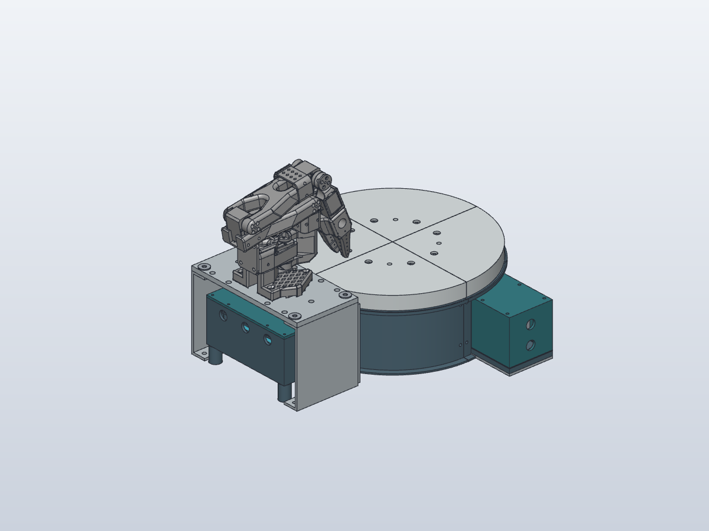
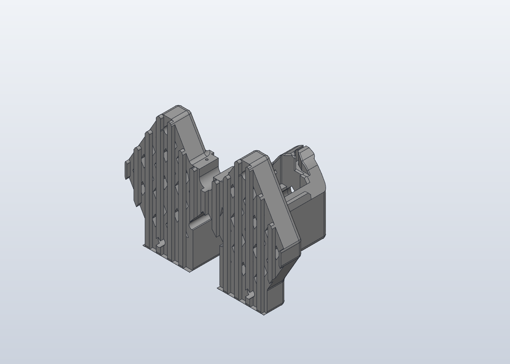

# SO-ARM100 reference models

Official SO100 geometry for designing Michelaingelo's future arm carrier and mounting adapter. This set uses the original **SO100** folders and the **follower** assembly.

The follower assembly is included in [michelaingelo.sc](../../michelaingelo.sc). In SolidCraft, expand **SO100 follower arm - mounted reference → Base_08q**. Choose the named view **RT01 and arm reference** for the mounted overview.

The current placement seats the measured base underside at **Z144**, with its footprint centred at **X0/Y−224**, facing +Y toward the platter. Source +X maps to project −X, source +Y to +Z, and source +Z to +Y. The imported geometry, scale and relative joint pose are unchanged. A rigid joint attaches the arm to the bench-supported metal bridge above the electronics box.

The four nominal Ø5 mounting passages were measured directly from `Base_08q (2)` and transferred to M50 as M4 clearance holes. Their irregular coordinates, source face indices and the rigid transform are recorded in [arm-mount-reference.json](../../cad/arm-mount-reference.json). Confirm the owned hardware revision, screw seating and fastener lengths before drilling metal. The arm's full reach, payload and dynamic deflection are not validated by the displayed pose.

The previous standalone placement is preserved in [the pre-mount archive](../../docs/archive/rt01-before-support-and-arm-mount.sc). Its earlier documentation described a Z0 seating plane; current exact face measurement found that imported base plane at Z86.1975 before relocation. The new placement explicitly uses that measured underside and seats it on the Z144 adapter.

Source: [TheRobotStudio/SO-ARM100](https://github.com/TheRobotStudio/SO-ARM100), pinned to commit [`a758567c3978dfeefe282ede0500085a48fe8f78`](https://github.com/TheRobotStudio/SO-ARM100/tree/a758567c3978dfeefe282ede0500085a48fe8f78), retrieved on 17 November 2026. Source file contents are unmodified. The three local STL filenames have been shortened; their original paths and SHA-256 hashes are recorded in [source-manifest.json](source-manifest.json).

Start mounting work with the first three STEP files below. STEP retains solid geometry for CAD measurements and adapter design; the STL files are the upstream print meshes.

| Local file | Purpose | CAD bounding box X × Y × Z, mm |
| --- | --- | --- |
| [Base_08q.step](step/Base_08q.step) | Main base body | 110.925 × 74 × 87 |
| [Base_attachment.step](step/Base_attachment.step) | Separate base attachment | 28.834 × 15.4 × 9 |
| [Motor1_holder.step](step/Motor1_holder.step) | First-motor holder | 44.7 × 31.4 × 80.2 |
| [STS3215_03a.step](step/STS3215_03a.step) | Servo reference geometry | 45.4 × 24.8 × 39.6 |
| [SO_5DOF_ARM100_Assembly.step](step/follower/SO_5DOF_ARM100_Assembly.step) | Complete follower-arm reference, in its exported folded pose | See the import note below |

These dimensions are bounding-box extents in the exported model axes. Confirm the base profile, servo arrangement and fixing locations against the owned arm before dimensioning the carrier adapter. The exact physical hardware revision has not yet been verified.

Individual follower base-group print meshes are available locally as [Base_08q-3.STL](stl/follower/Base_08q-3.STL), [Base_08q-4.STL](stl/follower/Base_08q-4.STL) and [Base_08q-5.STL](stl/follower/Base_08q-5.STL). They retain upstream coordinates and print orientations. STL coordinates have no embedded unit declaration; compare them with the millimetre STEP references when importing into a slicer or CAD tool.

For future printing on the Bambu A1 Mini, upstream also provides complete follower print layouts: [part 1](https://github.com/TheRobotStudio/SO-ARM100/blob/a758567c3978dfeefe282ede0500085a48fe8f78/STL/SO100/Follower/Print_Follower_SO_ARM100_08k_UP_BambuLabA1Mini_part1.STL) and [part 2](https://github.com/TheRobotStudio/SO-ARM100/blob/a758567c3978dfeefe282ede0500085a48fe8f78/STL/SO100/Follower/Print_Follower_SO_ARM100_08k_UP_BambuLabA1Mini_part2.STL). The [SO100 assembly/printing guide](https://github.com/TheRobotStudio/SO-ARM100/blob/a758567c3978dfeefe282ede0500085a48fe8f78/SO100.md) is the corresponding reference.

The base, base attachment, motor holder and servo STEP files each imported into **SolidCraft 0.43.0 as one closed solid**. The base reports an edge/surface tolerance gap of up to **0.0609 mm**; the separate attachment, motor holder and servo imported without warnings. Measurements, the base warning and mesh checks are recorded in [inspection.json](inspection.json).

The full follower assembly opened with 19 placed bodies: 18 closed solids and one open surface named `SO_ARM100_08k_Mirror`. SolidCraft reported tolerance/seam warnings and omitted two faces during that import. The original STEP is preserved. The individual base files isolate the mounting geometry; the full assembly is useful for overall visual/layout reference. Its [preview](follower-preview.png) shows the exported folded pose, whose bounds do not describe the arm's reachable carving envelope. Full import warnings are retained in `inspection.json`.

Third-party source geometry is by TheRobotStudio and the SO-ARM100 contributors. Upstream declares **Apache-2.0**; its [LICENSE](LICENSE) and [CITATION.cff](CITATION.cff) are included. The preview PNGs and `inspection.json` are derived inspection artifacts; the source STEP/STL files remain unmodified. The main project includes SolidCraft's imported representation, with the limitations described above.
